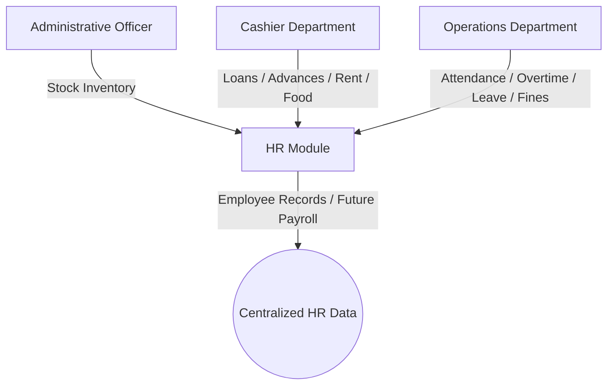
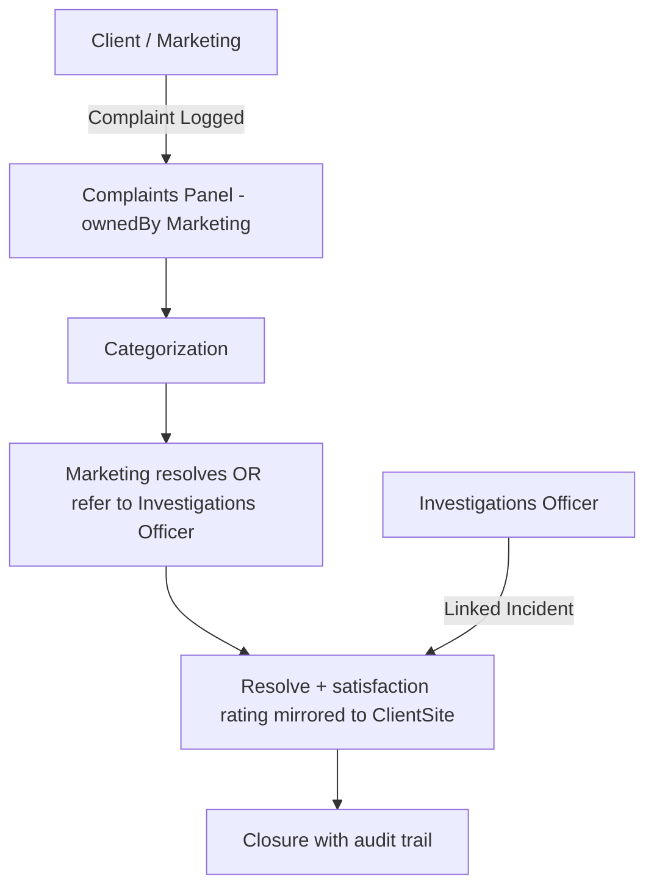

# Integrated Security Company Management System (ISCMS)
## Master Specification — Vision, Architecture, Requirements, RBAC, and Implementation Record

> This is the single, unified working reference for the ISCMS project — one document, not a split constitution-plus-lockdown pair. It documents the delivered system end-to-end: organizational structure, implemented architecture, data model, API surface, departmental requirements, role-level access, every workflow chain, and the build record. It reflects what is currently built and running, with genuinely future/deferred work clearly marked as such. Where earlier build-log entries in §28 describe a rule that was later corrected, the correction is reflected in the operative sections above (§7–§26); §28 entries are kept as dated historical record and are not themselves instructions to follow.
>
> **Terminology:** all personnel formerly called "guards" are **Security Officers** platform-wide — Prisma model `SecurityOfficer` (key: `forceNumber`), role/designation `Security Officer`, module `security_officer_portal`. Dated entries in §28.1–§28.17 retain legacy wording as historical build records.
>
> This document is the single working reference for planning, analysis, architecture, implementation, current-state understanding, and future expansion of the system, and the single prompt block for any AI coding agent working on it.

---

## 1. Project Identity

**Project Name:** Integrated Security Company Management System (ISCMS)

**Project Type:** Internal enterprise management system for a security company, designed from the start to grow into a multi-tenant SaaS ERP for security firms.

**Primary Purpose:** Digitize and streamline company operations, centralize departmental data, reduce manual work, improve accountability, and support management decision-making through a single integrated platform.

---

## 2. Vision, Goals, and Long-Term Direction

### 2.1 Vision
Build a secure, scalable, modular, maintainable, and user-friendly management system that supports the full operations of a security company and can later evolve into a commercial multi-company SaaS ERP platform.

### 2.2 Project Goal
Replace manual and paper-based workflows with an integrated digital platform where every department collaborates through a centralized system. The system should:

- eliminate duplicate data entry,
- improve accountability,
- automate repetitive tasks,
- improve reporting,
- give management real-time operational visibility,
- create a reliable foundation for future modules such as payroll, finance, analytics, mobile access, and multi-company support.

The system must prioritize usability, performance, security, maintainability, and future scalability over quick implementation.

### 2.3 Long-Term Vision
The system should eventually become a comprehensive ERP platform tailored to security companies, with configurable workflows, extensible modules, support for multiple organizations, reusable architecture, strong access control, auditability, and no need for major architectural rewrites when the system grows.

---

## 3. Project Philosophy and Core Principles

1. Build for the future, not only the present.
2. Design every module to be independent but integrated.
3. Keep the system modular.
4. Prefer reusable components over duplicated code.
5. Never sacrifice maintainability for speed.
6. Every feature should solve a real business problem.
7. Every module must integrate cleanly with others.
8. Every important action must be auditable.
9. Documentation should evolve alongside the code.
10. User experience is a core feature, not an afterthought.

Additional engineering rules: follow DRY, follow SOLID, follow KISS, keep business logic separate from UI, avoid unnecessary frameworks and libraries, keep naming consistent, write production-quality software, document complex logic, design for future expansion, and keep the system understandable for future developers and AI agents.

---

## 4. AI Responsibilities and Operating Role

When interacting with this project, the AI should act as: Senior Software Architect, Senior UI/UX Designer, Senior Backend Engineer, Senior Frontend Engineer, Database Architect, Security Engineer, DevOps Engineer, QA Engineer, Business Analyst, Technical Documentation Writer.

### 4.1 Responsibilities
Analyze business requirements, identify missing business processes and edge cases, suggest structural and operational improvements, design scalable architecture, design normalized database schemas, produce maintainable production-quality code, write and update technical documentation, optimize performance, improve security, improve user experience, review existing code critically, and ask clarifying questions when business logic is unclear.

### 4.2 Mandatory Behaviour
The AI must not assume requirements without evidence, rush into implementation, generate tutorial-quality code, introduce unnecessary dependencies, or ignore maintainability.

Before implementation: understand the business process, understand why the feature exists, identify missing requirements, suggest improvements, explain architectural decisions, compare alternatives where needed, recommend the best approach, and only then write code.

**This governs how any change against this spec should be approached: reconcile, don't rebuild.** Treat the current codebase as the starting point and this document as the target state:
- **Already matches this spec?** Leave it alone.
- **Conflicts with this spec** (wrong approver, wrong chain, wrong threshold)? Fix it to match — "Known Gap" notes throughout call these out.
- **Genuine duplication or unnecessary cruft** (explicitly flagged where known)? Remove it.
- **Exists in the system, works fine, was never discussed in this spec?** Leave it in place. Silence means the conversation didn't get there, not that it's wrong. Only remove something because it actively conflicts with a stated rule, never merely because it isn't mentioned. When in doubt, preserve and flag for a follow-up decision rather than delete outright.

---

## 5. Development Philosophy and Coding Standards

### 5.1 Development Philosophy
Built like a serious enterprise system, not a demo. Do not immediately write code. Always understand the problem first. Ask if business requirements are unclear. Suggest improvements. Identify missing functionality. Propose architecture before implementation. Only proceed after architectural alignment.

### 5.2 Coding Standards
Generate production-quality software, never tutorial-quality. Follow SOLID, DRY, KISS, Separation of Concerns, Clean Architecture where appropriate, Modular Design, Consistent Naming, Strong Typing where applicable, Reusable Services, Reusable Components. Avoid unnecessary complexity, unnecessary libraries and frameworks, shortcuts that break maintainability, and code that only works for tutorials or prototypes. Document complex business logic clearly.

---

## 6. UI / UX Standards and Design System

The application must look and feel like modern enterprise software: clean, minimal, spacious, professional, responsive, accessible, consistent — handcrafted, not AI-generated. **The system should be interactive, engaging, and fun to use** — not a boring enterprise tool. Every interaction should feel purposeful and satisfying.

### 6.1 Design Principles
Handcrafted, intentional, modern, fast, intuitive, and easy to use across desktop, tablet, and mobile. **Organized layout** is a must — every page has a clear visual hierarchy, logical grouping of related elements, and consistent spacing. The system should feel like a product people *want* to use, not one they *have* to use.

### 6.2 Avoid
Flashy gradients, oversized icons, cartoon graphics, excessive animations, inconsistent spacing, generic AI-looking dashboards, random colours, cluttered layouts, or designs that feel rushed or template-generated.

### 6.3 Reusable UI Components
Buttons, Cards, Forms, Tables, Data Grids, Badges, Alerts, Modals, Drawers, Navigation, Sidebar, Header, Footer, Tabs, Breadcrumbs, Search, Filters, Pagination, Statistics Cards, Charts, Timelines, Activity Feeds.

### 6.4 Mandatory UX States
Loading, Empty, Error, Success, Permission, Validation, Confirmation Dialogs, Search, Filtering, Sorting, Pagination, Keyboard Accessibility, Responsive Design.

### 6.5 Interactive Features (Required)

**Wizards:** complex multi-step processes use guided wizard flows with progress indicators, back/next navigation, and step validation. Required for: contract creation, deployment order creation, HR biodata enrollment, staff contract creation, peaceful exit clearance process, procurement requests.

**Tooltips:** every non-obvious field, section, icon, and action has a contextual tooltip explaining what it does, why it matters, and what the expected input is. Tooltips appear on hover/focus, are dismissible, and use consistent styling. Especially important for: financial fields, status codes, approval actions, filter options, and any field with business-specific terminology.

**History/Activity Logs:** every individual user sees their own contribution history tied to their account — clients brought in, site surveys conducted, deployment orders issued, contracts drafted, incidents reported, complaints resolved, approvals given, training cohorts managed. These appear as activity feeds on individual profiles and as summary widgets on dashboards. The logs are filterable by date, action type, and module.

**Confirmation Dialogs:** every destructive or irreversible action (delete, void, terminate, approve, submit) requires a confirmation dialog with clear explanation of what will happen. No accidental destructive actions.

**Feedback:** every action produces immediate, visible feedback — success messages, error messages, loading states, progress indicators. Users always know what happened and what to do next.

**Drillable Dashboards:** dashboard cards and KPIs are clickable, leading to filtered detail views. Regional summary cards click through to region-specific data. Incident trend charts click through to the incident list filtered by that trend. Every summary number links to the underlying records.

**Search & Filter:** global search across modules; per-page search and filter with multiple filter criteria, saved filter presets, and keyboard shortcuts for common operations.

### 6.6 Organized Layout Standards
- **Visual hierarchy:** headings, subheadings, and body text use consistent sizing and weight. Primary actions are visually prominent; secondary actions are subdued.
- **Logical grouping:** related fields and actions are grouped together with clear section headers. Forms use fieldsets with labels. Dashboard widgets are organized by workflow relevance, not random placement.
- **Consistent spacing:** use a spacing scale (4px base) for all margins, padding, and gaps. No arbitrary pixel values.
- **White space:** generous white space prevents visual clutter. Every page breathes — content is not crammed together.
- **Responsive grid:** content adapts cleanly from desktop to tablet to mobile. Tables become card lists on small screens. Sidebar collapses to a hamburger menu.

---

## 7. Organizational Structure

Where the system is unsure about process ownership, this structure is the reference point. **§28 extends this structure with a per-role duty and system-access matrix.**

### 7.1 Executive Directorate

```
Board of Directors — governing body, strategic review, exception escalations; sits above the General Manager
└── General Manager — executive authority on the ground, company-wide KPIs, final operational approvals
```

The Board of Directors sits above the General Manager in the reporting structure — the General Manager reports to the Board, not the reverse. This is a governance/hierarchy relationship only; it does not change either role's system access. Both roles are **view + approve only** at the system level: they review company-wide KPIs and give final approval on escalated items but do not create or edit operational records (least privilege — see §26.10).

- **Director (Board):** pure oversight at the system level. Zero approval power, zero operational access, anywhere, ever — Directors are not always on-site, and day-to-day operational authority is delegated in full to the General Manager.
- **General Manager:** the executive on the ground, reporting to the Board. **Sole approver, with no amount-based threshold, on: Contracts (client and staff), Requisitions from any department, Expenses, and Campaign Budgets.** There is no split between "GM approves above X" and "someone else approves below X" on any of these four. Full access to Directorate + Reports & Analytics. No CRUD in any department's day-to-day operations.

### 7.2 Human Resource Department
```
HR Manager — head, employee records, contracts, leave, discipline, performance source data
├── HR Assistant — day-to-day processing and records support
└── Records Officer — personnel file integrity and archival
```
Responsibilities: employee records, contracts, leave tracking, deployment records, discipline, training, transfers, performance review, payroll-related source data.

### 7.3 Marketing Department
```
Business Development Manager — head, leads, pipeline, client engagement, campaign budgets, client satisfaction
└── Sales and Marketing Supervisor — sales pipeline execution, campaigns and market outreach
```
Responsibilities: leads, sales pipeline, marketing campaigns, follow-ups, client engagement, social media management (LinkedIn, X, TikTok).

### 7.4 Operations Department

```
Operations Manager (Department Head) — overall head, owns deployment, attendance, shifts, armoury, K9, and training
├── Regional Manager(s) — regional command across company regions; outpost and station oversight; a distinct system role with its own login and region-scoped dashboard — not a rank someone is promoted into
│   └── Security Officer — front-line security officer; reports to the Regional Manager; uses the Security Officer Portal
├── Armorer — armoury vault issue/return, chain of custody, ballistic accountability
├── K9 Unit Lead (K9 Supervisor) — canine unit command, handler pairing, health and deployment
│   └── K9 Handler(s) — field handler paired with assigned canine
└── Training Officer — training academy cohorts, pass-out, and operational readiness
```

**Rank vs. role.** Front-line personnel hold a **rank**, recorded on the Security Officer record — a three-rung ladder: **Security Officer → Site In-Charge → Inspector.** Regional Manager is **not** part of this rank ladder — it is a separate, already-fully-implemented system role (own login, own region-scoped dashboard) that someone moves into, not a rank they're promoted through. Operations Manager is likewise a management position, outside the rank ladder entirely.

**Rank-as-login-role status:** the Security Officer Portal (check-in/out, own leave requests, own incident reporting, own duty roster, own disciplinary record) is already live for every Security Officer regardless of rank — this stays exactly as built. What is **paused** is giving **Site In-Charge and Inspector their own differentiated, rank-specific capabilities** (site-scoped attendance/incident oversight for Site In-Charge; personal patrol-inspection logging for Inspector) — not officer login access itself, which already exists. Revisit after biodata/enrollment is stable in production use.

**Fleet is an independent top-level department, not a child of Operations** — see §7.4c. (A Fleet Manager reporting into Operations is a superseded description; do not model Fleet as part of Operations anywhere — org chart, nav grouping, or department counts.)

Operations responsibilities: deployment, attendance, shifts, leave escalation input, performance notes, armoury management, K9 unit operations, training school management.

**Operations Manager specifics:**
- Direct reports: Regional Manager, Armorer, K9 Unit Lead, Training Officer.
- Role is KPI/analytics oversight across regions — **not** operational CRUD. Cannot add armoury items, manage K9 records, touch Fleet, or manage HR records directly.
- Issues deployment orders (headcount needed); **Regional Manager** selects which specific security officers fill each order.
- **Zero contract authority** — no approve, no reject, no void, ever (see §9.7). If OM needs contract info, submits a Contract Inquiry to Records Officer.
- **Does not request site surveys.** Marketing always requests the survey (see §9.7); OM only conducts/contributes to it. OM has a **read-only history/log of site surveys he's conducted**, for accountability.
- IT module access: view-only at most.

**Regional Manager specifics:**
- Oversees the rank ladder (Security Officer → Site In-Charge → Inspector) at their own region only.
- **No authority** over other departments' staff physically located at their regional office (finance, marketing, etc. stay under their own department heads).
- First approval step on disciplinary actions originating in their region.
- Can delegate non-sensitive work (e.g. shift scheduling) down to Inspector; not sensitive work.

**Inspector (rank):** personally logs/submits patrol inspection records directly.

**Site In-Charge (rank):** handles attendance/check-in oversight and incident reporting, scoped strictly to their own site.

**Security Officer record:** carries an assigned site (ties check-in/attendance to a specific Site In-Charge's location).

### 7.4b Investigations Department (Independent)

The Investigations Department is organizationally independent — not under Operations, though it shares information with Operations:

```
Investigations Officer (Department Head) — independent internal investigations
├── Incident Logbook — case tracking, evidence, escalation, resolution tracking
├── Referred Complaints — complaints from Marketing linked to incident records
└── Disciplinary Charge Sheet — initiates Category 1 / 2 / 3 charge sheets
```

Two Investigations Officers are **peers** — either can handle any case, no senior/lead distinction.

Responsibilities: incident investigation (ownership, evidence, escalation, resolution tracking), disciplinary charge-sheet initiation, complaints referred for investigation, shares information with Operations (escalations and approvals) but reports directly to the Directorate.

**UI placement:** Operations' workspace surfaces a single **Incidents tab/section** (a slice of shared Ops↔Investigations data) for the day-to-day collaboration — not a full nested Investigations-department view embedded inside the Ops workspace.

### 7.4c Fleet Department (Independent)

```
Fleet Manager (Department Head) — owns the patrol fleet: vehicles, drivers, riders, fuel, maintenance, insurance
```

Fleet is a fully independent top-level department, reporting directly to Directorate — not a child of Operations. See §10 for functional module detail and §9.6/§9.9 for the Transport Request workflow.

### 7.5 Finance Department
```
Finance Manager — head, invoices, expenses, budgeting, financial reporting
├── Accountant — books, reconciliations, reporting
│   └── Assistant Accountant — transaction support
├── Internal Auditor — independent financial controls review
└── Cashier — advances, food, rent, loans, petty cash
```
Responsibilities: financial tracking, client invoices, payments, receipts, expenses, budgeting, reporting, deductions and advances feeding future payroll.

### 7.6 Administration Department
```
Administrative Officer — uniforms, shoes, equipment inventory and issuance (distinct from IT assets)
```
Responsibilities: inventory control, uniform and shoe stock, asset issuance, administration support, feeding inventory data to HR-related processes.

### 7.7 Information Technology Department
```
IT Officer (Systems Overseer) — head, users, roles, rights, system health, IT hardware/software assets, PVC ID coordination, region CRUD, custom role definitions
```
Responsibilities: creating users, creating and managing roles, granting rights and access, suspending users, deleting users, monitoring the system, maintaining system health, system administration, access control support, system-level governance, owning IT-issued hardware/software assets (distinct from Administration's uniform/shoe/equipment inventory).

### 7.8 Why this structure matters
When business rules are unclear, use this structure to decide who owns which data and who approves which actions. For the granular question of who may view, create, edit, delete, or approve specific records within each department, see §28.

---

## 8. System Architecture — Implemented State

### 8.1 Technology Stack (Implemented)

| Layer | Technology | Purpose |
|---|---|---|
| Frontend Framework | React 19, TypeScript | UI rendering, strict domain-driven types |
| Build Tool | Vite 6 | Dev server, HMR, production bundling |
| CSS | Tailwind CSS v4 (compiler-first) | Styling, minimal CSS bundles |
| Routing | React Router v7.18.1 | Client-side routing with deep links |
| State Management | Zustand v5.0.14 | Centralized stores |
| UI Component Architecture | Atomic Design (atoms/molecules/organisms/views) | ~70 extracted components, all views under 320 lines |
| Charts | Recharts, Lucide Icons | Data visualization |
| Animation | Motion (framer-motion) | UI transitions |
| API Server | Express 4 | RESTful CRUD API |
| Database ORM | Prisma 7 (PostgreSQL adapter) | 43 models, typed client |
| Database | PostgreSQL | Persistent relational storage |
| Auth / Security | JWT, bcryptjs, Zod, DOMPurify | Token auth, password hashing, schema validation, HTML sanitization |
| Server-Side RBAC | Express middleware | Per-module access gates on every API route |
| Validation | Zod v4 | Schema validation, client and server |
| Document Export | docx + file-saver | DOCX generation and download |
| Bundling | esbuild | Server compilation |

### 8.2 Database Schema (Prisma — 47 Models)

43 models in `prisma/schema.prisma`, generated to `src/generated/prisma/`. Key domains: Auth & IT (`User`, `UserSession`), HR/Security Officer (`SecurityOfficer`, `SecurityOfficerBiodata`, `SecurityOfficerEmploymentContract`, `LeaveRequest`, `DisciplinaryAction`), Operations (`Region`, `RegionalOffice`, `ClientSite`, `SiteDeployment`, `DeploymentOrder`, `DutyRoster`, `PatrolInspectionLog`, `TrainingCohort`, `RecruitTrainee`, `AdminRequisition`), Armoury & K9 (`ArmouryItem`, `ArmouryLog`, `K9Dog`, `K9Log`, `K9HealthInspection`), Fleet (`Vehicle`, `VehicleTripLog`, `FuelLog`, `MaintenanceServiceLog`, `Driver`, `DailyVehicleInspection`, `FleetBreakdownEmergency`), Finance (`Invoice`, `Expense`, `CashierTransaction`), Marketing/CRM (`Lead`, `Campaign`, `Complaint`, `Contract`, `SiteSurvey`, `ContractInquiry`), Governance (`Incident`, `AuditLog`), Infrastructure (`ForceNumberSequence`, `Document`). **Removed:** `Workflow`, `WorkflowStep`, `Approval`, `ApprovalAction` — workflow engine has been deleted entirely (see §8.8).

Roles are free-form strings on `User.role`, validated against the 23-role `UserRole` union in `src/types.ts` (no Prisma enum — the legacy enum was removed as dead code).

### 8.3 Express API Server (`server.ts`)
Full Express API: Auth endpoints, business CRUD for security officers/sites/incidents/vehicles/invoices/expenses/leads/k9s/regions/leave-requests/documents/job-postings/candidates/performance-reviews/custom-roles, JWT authentication + per-module RBAC middleware, Zod validation, audit logging on all mutations, health endpoint, static serving. **Removed:** workflow engine endpoints — workflow engine deleted entirely (see §8.8).

### 8.4 Zustand Stores
`authStore.ts` (session/login/role switching), `domainStore.ts` (24+ entity arrays with full CRUD, cross-store audit logging), `auditStore.ts` (audit log array). **Removed:** workflow store — workflow engine deleted entirely (see §8.8).

### 8.5 Routing & Module Catalog
16 deep-linkable routes, role-filtered navigation via `getAllowedModuleIds()`: Directorate, Operations, Investigations, HR, Client & Sites CRM, Finance, Marketing, Transport (Fleet), Administration, IT, Security Officer Portal, Reports, Recruitment, Documents, Performance Reviews, Login. **Removed:** Workflow Engine — deleted entirely (see §8.8).

### 8.6 UI Component Architecture
Atomic Design: atoms (5), molecules (3), organisms (~70), views (18, all under 320 lines), layout (2), ui (3), hooks (multiple).

### 8.7 Security Architecture (Implemented)
JWT auth (24h expiry), bcrypt hashing, `requireModuleAccess(module, minLevel)` server-side RBAC middleware on every protected route, role-gated read endpoints, IT-Officer-only account provisioning (no self-registration), Zod validation on all endpoints, DOMPurify sanitization, client-side RBAC mirroring server-side.

> §28 defines the finer-grained, per-role duty and action-level access within a module, extending the module-level gating here.

### 8.8 Module Roadmap — Delivery Status

All core modules are **DONE**: Auth & Access Control, Executive Directorate, IT Administration, Human Resources, Operations, Administrative & Asset Management, Cashier & Petty Cash, Transport & Fleet, Client & Site CRM, Complaint & Incident Management, Marketing & Sales, K9 Unit, Armoury, Training School, Reports & Analytics, Audit & Logging, Security Officer Portal, Document Management, Recruitment & Staffing, Performance Management, Advanced Analytics, Dynamic Regions, Custom Roles, Role-Level Duty & Access Matrix (§28), Governance Chains, Full DB Persistence, Deployment Orders, Fleet Licence Approvals, Contract Scans & Template, ID Camera & Holder Signature, Digital Contracts (§9.8). **Removed:** Workflow Engine — deleted entirely (models, API endpoints, store actions, module navigation, permissions — all removed). The workflow engine's functionality is replaced by the documented workflow chains in §26.10, enforced through direct API routes and RBAC middleware rather than a generic approval framework.

**IN PROGRESS (current build scope, not deferred):** Notification Engine — in-app, email, SMS (WhatsApp explicitly excluded; push stays future) — see §9.10. Procurement Module, owned by the Administrative Officer — see §9.12. Fingerprint biometric capture at HR biodata intake (Mantra MFS100) — see §9.11. Public website complaint-submission form (distinct from a Client Portal — see §12).

### 8.9 Phase 2 — Planned Modules
Automated Payroll Engine, GPS Security Officer Tracking, broader Biometric Attendance (beyond the fingerprint capture already in scope, §9.11), Mobile App, AI & Advanced Analytics, Multi-Tenancy, External API Integrations. **Employee Self-Service Portal** has been partially moved to current build scope (§9.13) — contract status, job description, and contract PDF download for Security Officers are now current scope; the full broader self-service portal (leave requests, payslips, etc.) remains Phase 2.

**Explicitly out of scope — not deferred, not planned:** Client Portal (authenticated client self-service — invoice viewing, document access). The public website complaint-submission form (§12) is unrelated and already in current build scope; it is a small unauthenticated form, not a portal.

---

## 9. Departmental Operational Requirements

### 9.1 Finance & Marketing Department
Finance and Marketing are separate departments (§7); this section consolidates the client-facing data they share. Track: Client Name, Client Contact, Number of Security Officers, Client Invoice, Location, Customer Support, Marketing and Sales, Social Media Management.

**VAT handling:** client pricing and invoices support a **VAT inclusive/exclusive toggle**. When creating or editing a client contract or invoice, the user selects whether the stated price is VAT-inclusive or VAT-exclusive. VAT rate is 18% (Uganda standard). The system calculates and displays the VAT amount accordingly. This toggle extends to: client contract pricing (§9.7/§9.8), invoice line items (Finance module), and any client-facing pricing display. The toggle default is VAT-exclusive (the more common B2B convention in Uganda).

### 9.2 Human Resource Department
**Implementation status: FUTURE-ONLY for payroll computation** (no code yet). Current build stores HR identity fields (force number, name, bank details, location, status, NSSF No, TIN, tel no, contracts, leave/maternity tracking); payroll computation fields (days worked, overtime, bonuses, deductions, Basic/Gross/PAYE/NSSF/net, shoes/uniform/advance/food/fine/rent/loan/refund) are tracked by Cashier/Administration as inputs, feeding a future automated payroll engine.

**Fingerprint capture at biodata intake — current build scope.** HR captures a fingerprint at biodata intake for every hire, **Security Officer or any other staff role**, via a **Mantra MFS100 USB fingerprint scanner**. See §9.11 for the full capture-flow and storage specification.

### 9.3 Administrative Officer
Handles stock inventory for shoes and uniform, feeding the HR module.

### 9.4 Cashier Department
Tracks rent, food, loans, advances, feeding HR and future payroll processes.

### 9.5 Operations Department

Track: days worked (from managers), deductions and fines (suggested by managers, approved by HR), overtime, leave (Security Officer → HR Manager → optional GM, see §9.7b).

**Shift times (canonical):** Day shift = 07:00–18:00; Night shift = 19:00–06:00. Each shift is 11 hours. One shift worked = one payroll day. Two shifts in a calendar day (both Day and Night) = one regular day + one day overtime. Overtime auto-detects when a Security Officer is rostered for both shifts in the same day; overtime days contribute to payroll calculations.

**Payroll day rules:** 1 shift = 1 day. 2 shifts = 1 regular day + 1 overtime day. These feed the future automated payroll engine (§8.9).

**Security Officer lifecycle (canonical path — final):**
1. Operations mobilizes/recruits candidates in the field. **This phase is entirely off-system** — nothing is recorded until the recruit physically reaches the organization.
2. On arrival, **HR captures biodata and enrolls** (stage `ENROLLED`) — the actual point a Security Officer record first exists in the system.
3. HR hands the Security Officer to Operations (stage `HANDED_TO_OPERATIONS`).
4. Operations sends the Security Officer to the Training Academy (stage `IN_TRAINING`); Training School is notified.
5. Training Officer trains and marks pass-out (stage `PASSED_OUT`); OM is notified. Training School UI surfaces top performers/qualifications from the cohort — a genuine UI feature, not just a pass/fail log.
6. OM decides which region needs the officer; **Regional Manager** deploys to a specific site (stage `DEPLOYED`); also set automatically when a scheduled officer checks in on the duty roster.

Transition rights: HR moves `ENROLLED → HANDED_TO_OPERATIONS`; Operations Manager/Regional Manager move `HANDED_TO_OPERATIONS → IN_TRAINING` and `PASSED_OUT → DEPLOYED`; Training Officer moves `IN_TRAINING → PASSED_OUT`. HR moves `ACTIVE → COMPLETED_CONTRACT` (peaceful exit / contract completion) or `ACTIVE → TERMINATED` (with mandatory reason). `COMPLETED_CONTRACT` officers are eligible for re-employment — see Alumni/Rehire Registry below. Regional Managers see only officers in their own region. All lifecycle-stage transitions fire real in-app notifications.

**Pass-out certificate auto-generation:** when Training Officer marks a cohort pass-out (`IN_TRAINING → PASSED_OUT`), the system auto-generates a pass-out certificate PDF for each Security Officer in the cohort. The canonical copy is stored in the Records Officer's vault (§26.11). Operations Manager receives a notification with a viewable link to the certificate. The certificate includes: officer name, force number, cohort details, training dates, pass-out date, and company letterhead (§9.15).

**Alumni/Rehire Registry:** officers whose lifecycle stage is `COMPLETED_CONTRACT` appear in an alumni registry visible to HR Manager. Re-employment flow: HR Manager changes stage from `COMPLETED_CONTRACT` back to `ENROLLED` (or appropriate stage), triggering the standard enrollment workflow. The registry tracks: original force number, dates of service, reason for contract completion, and re-employment eligibility status.

**Peaceful Exit Process Flow (Resignation):**
1. Staff member submits resignation letter via digital form in the system.
2. HR Manager reviews, checks notice period requirements.
3. HR Manager initiates clearance process — system generates a clearance checklist routed to each relevant department:
   - Administration: uniform/shoes returned
   - Armorer: firearms/weapons returned (fingerprint sign-back, §11)
   - Records Officer: ID card returned
   - IT: company phone/laptop returned, access revoked
   - Fleet: vehicle keys returned (if applicable)
   - Finance: outstanding advances/loans settled
4. Each department confirms receipt via digital sign-off in the system.
5. Finance clearance: final salary calculated, deductions settled.
6. HR Manager changes lifecycle stage to `COMPLETED_CONTRACT`.
7. Records Officer archives employee records.
8. Officer added to Alumni/Rehire Registry.

**Contract Completion (natural expiry):** system notifies HR Manager 30 days before contract expiry. HR Manager decides: renew or complete. If complete: same clearance process as resignation (steps 3–8).

**Termination (with mandatory reason):** HR Manager initiates with mandatory reason documented. Same clearance process. HR Manager changes stage to `TERMINATED`. Records Officer archives.

**Deployment Order — Data-Driven Flow:**
The Operations Manager needs regional data to issue informed deployment orders. Before issuing an order, the system surfaces:
- How many Security Officers are currently in each region (and their availability).
- How many clients are in each region.
- Per client contract/survey: how many officers are needed per shift (day and night shifts).
- Current deployment status (how many officers already deployed vs. available pool).
- Requested dates of deployment, client name, and site details.

OM reviews this data and issues the order specifying headcount, shift type, dates, region, client, and site. The **Regional Manager** then selects which specific officers from the region's pool fill each shift — the OM does not assign individual officers to shifts; the RM makes that operational decision based on local knowledge.

**Recruitment (non-Security-Officer roles):** for Security Officer positions, HR posts/screens and builds a shortlist → **OM personally interviews and selects** from the shortlist → HR finalizes hiring, captures biodata, enrolls. For non-Security-Officer roles (drivers, office staff), HR handles the pipeline end-to-end, no OM involvement.

**Security Officer Transfers:** OM initiates/approves the transfer (operational decision); HR (Assistant) then updates the officer's HR record to reflect it (status, region, history) — HR documents, doesn't initiate.

**Deployment orders (Order → Regional Manager fill).** The Operations Manager issues a deployment order for a client site (`ORD-YYYY-NNN`) specifying headcount, shift type, dates, region. Only the Operations Manager issues an order; only a Regional Manager fills it (`PUT /api/deployment-orders/:id/assign`), from officers in the matching region whose lifecycle stage is not yet `DEPLOYED`. A filled order assigns officers and promotes them to `DEPLOYED`. Sites remain **view-only for Operations**; created only by Marketing/Sales.

### 9.6 Fleet Department (Independent — see §7.4c)

Track: drivers and riders, vehicles and motorcycles, fuel, repairs, maintenance/service, vehicle/motorcycle registration, routing and scheduling, licences, service history, insurance expiry. Full module detail in §10.

### 9.7 Contract Ownership & Approval Workflow (Client Contracts) — FINAL

```
Marketing wins the client
   → Marketing requests a Site Survey from Operations
       (survey = pure risk assessment: what does the site need — nothing beyond that)
       → If marketing person is at HQ: request to Operations Manager
       → If marketing person is at a regional office: request to that Regional Manager
       → If client has branches in other regions: survey requests sent to each relevant Regional Manager
   → Survey conducted → Survey results sent back to Marketing
   → Records Officer drafts the contract (receives survey data + client details from Marketing)
   → General Manager OR Finance Manager reviews and approves
       (either may approve — first-come-first-served, no threshold, big or small — standing authority for both, not conditional on GM's absence)
   → Contract signed — sequential signing (see §9.8):
       Company Representative (whichever of GM/Finance Manager approved, or GM by default)
       + Company Witness (the marketing person who brought the client, or Records Officer's selection from dropdown if unavailable)
       → Client Representative + Client Witness
   → Records Officer holds/archives (confidential — not broadly visible across the org)
```

- **Records Officer drafts the contract** — not Marketing. Marketing provides the client details and survey data; the Records Officer uses the contract templates (§9.8) to draft the document.
- **Operations Manager has zero approve/reject/void authority on contracts, period.**
- **Approval and signing on client contracts are both shared, standing rights between General Manager and Finance Manager — first-come-first-served, no threshold.** Either may approve a client contract; either may sign as Company Representative/Company Witness (§9.8). This is **standing authority for both roles at all times**, not a fallback that only activates when GM is absent — no acting-privilege grant, no HR-initiated request, no IT involvement needed for this. (Requisitions, Expenses, and Campaign Budgets are unaffected by this — those remain the General Manager's sole authority, §7.1.)
- No executive-target exception is needed in the acting-privilege system (§26.9) for this case — it was built for a fallback scenario that this simpler standing-authority rule now replaces entirely.
- **Signing order: Company signs first, then client signs.** The company representative and company witness sign first (committing the company), then the contract is sent to the client for their signature (accepting the terms).

**Client Commission (off-system, system-tracked):**
- When a staff member brings in a **new client** (client did not previously exist in the system), the system marks them as **eligible for commission** on the client record.
- If the client **already exists** as a company client and the staff member is adding a **new site**, no commission eligibility is assigned.
- Commission eligibility is tracked per-staff-member on the client record — the commission amount, percentage, and payment are discussed and settled off-system.
- **Any staff member** (not just Marketing) can bring in a new client and be eligible for commission — the system tracks who originated the client relationship.
- The client record carries a `broughtInBy` field linking to the staff member, and a `commissionEligible` boolean flag.

**Contract Inquiry (confidentiality mechanism).** Contracts are confidential and not broadly visible; anyone needing contract information without full access submits an inquiry:

`Requester asks (Confirmation | Full Copy) → Records Officer inbox → responds with a downloadable PDF → requester's outbox shows the response`

**Confirmed requester list (final):** General Manager, Operations Manager, Finance Manager, HR Manager. (Internal Auditor proposed but explicitly left out for now.)

**Staff contracts** (unchanged): `Draft` (HR Assistant prepares) → `Active` (HR Manager issues) → `Expiring Soon`/`Expired` (auto-derived) → `Terminated`/`Archived` (HR Manager voids with reason, or Records Officer archives). Only HR Manager issues/voids; Records Officer archives. There is **no hard delete on contracts or Security Officers** — void (with mandatory reason) or archive only.

**Contract scans & printable template.** Contracts carry a persisted multi-page scan set (`Contract.scanPages`) — add page, thumbnail list, reorder, delete. A Print Template button renders a print-ready contract that auto-prints from the browser.

### 9.8 Digital Contracts System

PDF-based workflow: fixed legal contract PDFs uploaded as templates, contracts created from those templates with auto-generated IDs, signed sequentially, stored with tamper-evident SHA-256 hashes. The uploaded PDF template is the source of truth — the system never modifies contract wording, only fills client-specific fields and overlays signatures + company stamp.

**Template management (Records Officer):** upload fixed legal PDF templates, company stamp image, stored at `digital_contracts/templates/`.

**Contract creation (Records Officer):** Records Officer drafts contracts from templates, using client details and survey data provided by Marketing. 6-step wizard (Select Template → Client Details → Service Details → Contract Dates → Signatories → Review). Auto-generated Contract IDs: Client `CC-YYYY-ABBREV-NNN`, Staff `SC-FORCENUMBER-NNN`, Scanned `SCAN-YYYY-ABBREV-NNN`. **VAT toggle** (§9.1): client contract pricing includes a VAT inclusive/exclusive selector — the stated service fee is marked as either including 18% VAT or excluding it, with the system calculating and displaying the VAT amount accordingly.

**Approval (Client Contracts only):** General Manager or Finance Manager reviews and approves contract content before signing begins — shared standing authority, first-come-first-served, no threshold (§9.7). Staff Contracts skip this step.

**Sequential signing:** 4 signature blocks — Company Representative, Company Witness, Client Representative, Client Witness. **Company signs first** (Company Representative + Company Witness commit the company), then client signs (Client Representative + Client Witness accept the terms). Internal signers sign first, then client signers via secure link (64-char hex token, 14-day expiry, rate-limited, single-use, no login required). **Company Witness selection:** Records Officer selects the Company Witness from a dropdown — default is the marketing person who brought in the client; if that person is unavailable, Records Officer selects another eligible witness from the dropdown.

**Finalization:** all 4 signers complete → original template PDF loaded (all pages preserved) → Signature Certificate page appended (all 4 signatures, names, titles, timestamps) → company stamp overlaid → SHA-256 hash computed → finalized PDF stored at `digital_contracts/contracts/`.

**Role access:**

| Role | Access |
|------|--------|
| Records Officer | **Draft client contracts** from templates, upload templates, upload company stamp, view signed, archive, manage inquiries, select Company Witness for signing |
| HR Manager | Create Staff Contracts from templates, full e-sign access on staff contracts |
| HR Assistant | Prepare Staff Contract drafts, full e-sign access on staff contracts |
| General Manager | **Approve** (shared standing authority with Finance Manager, first-come-first-served, no threshold) + **Sign** Client Contracts |
| Finance Manager | **Approve** (shared standing authority with General Manager, first-come-first-served, no threshold) + **Sign** Client Contracts — standing, not conditional on GM's absence, no acting-privilege grant needed |
| Public (no login) | Client signers access secure links to sign |

**Contract lifecycle:** `Draft → PendingApproval (Client only) → PendingSigning → PartiallySigned → FullySigned → Archived`.

**Scanned old contracts:** old paper contracts digitized via `SCAN-YYYY-ABBREV-NNN` uploads. **Broader legacy paper-record migration (beyond scanned contracts) is explicitly deferred** — get the working system live first; migration will mix document upload and direct data entry, scoped later.

### 9.9 Transport Request Flow (Fleet) — FINAL

1. **Requester:** any full-time operational staff member, **including the General Manager**. **Directors excluded** (not on-site staff). **Security Officers excluded** — Security Officers use deployed vehicles at their assigned sites, not the central transport pool.
2. Request lands in the **Fleet Manager's** inbox.
3. Fleet Manager checks driver/vehicle/rider availability and **assigns**: vehicle *or* motorcycle, driver *or* rider, and the plate number.
4. **Approve:** requester notified with the assigned details.
5. **Decline:** Fleet Manager gives a reason via an interactive form — **dropdown of common reasons** (no driver available, vehicle in maintenance, etc.) **plus a custom/free-text option**.
6. Every action is audit-logged.

### Known Gap
- Confirm the decline-reason UI has the dropdown+custom pattern described above; add it if currently free-text-only or missing.

---

## 9.7b Leave Workflow — FINAL

`Submit → HR Manager approves → [optional, at HR Manager's discretion] General Manager gives final approval`

- **Live and correct as built.** The server already enforces exactly this: `PUT /api/leave-requests/:id/approve` and `/ops-approve` (the old Regional Manager and Operations Manager approval steps) both return **410 Gone** with the message *"…step removed. Submit → HR Manager → optional GM."* Only `/hr-approve` and `/gm-approve` are live. No further backend work needed here — this section documents the confirmed final rule, not a gap.
- HR Manager decides, per request, whether to finalize approval herself or escalate to the General Manager. The clearest case for escalating is when **the requester is themselves a manager** — HR Manager is not obligated to be the one who signs off on a fellow manager's leave.
- **Requester is the General Manager, or another department manager at HR Manager's own level:** HR Manager still processes the approval step, but **cannot deny it** — for these requesters, HR Manager's step is a formality/audit-log entry, not a real gate; only the General Manager can decline that request. This is already enforced server-side via the reject route's non-deniable-requester check.
- HR Assistant is not an approver. Reject-with-reason available at any step (subject to the non-denial rule above).

**Leave balance tracking:** entitlement/taken/balance must show real computed data — this was previously incomplete (blank dashes) and is a required fix, not cosmetic polish.

---

## 9.10 Notification Engine — Current Build Scope

Moved from planned to active build. **Channels: in-app, email, SMS. WhatsApp explicitly excluded. Push notifications remain future work**, not yet greenlit.

**Delivery rule:** every trigger below fires the in-app notification unconditionally (already the pattern used throughout the system via `notifyRole`/direct-user notification). Email and SMS are added on top of in-app for the triggers marked **[E/S]** below — time-sensitive items where someone genuinely needs to know outside the app, not decorative duplication of everything already visible in-app. **Audio notification:** new in-app notifications play a subtle notification sound by default (configurable per-user in notification settings).

**Confirmed trigger set** (compiled from every workflow already defined in this document — build against this list, extend only for triggers this document doesn't yet cover):

| Trigger | Notifies | Channel |
|---|---|---|
| New leave request submitted | HR Manager | in-app |
| Leave escalated to GM | General Manager | in-app **[E/S]** |
| Leave approved/rejected | Requester | in-app **[E/S]** |
| New Security Officer enrolled (`ENROLLED`) | Operations Manager | in-app |
| Security Officer handed to Operations | Operations Manager | in-app |
| Security Officer sent to Training | Training Officer | in-app |
| Security Officer passes out | Operations Manager | in-app **[E/S]** |
| Deployment order issued | Regional Manager (matching region) | in-app **[E/S]** |
| Deployment order filled | Operations Manager | in-app |
| Transport request submitted | Fleet Manager | in-app **[E/S]** |
| Transport request approved/declined | Requester | in-app **[E/S]** |
| Driver/Rider licence pending approval | Fleet Manager | in-app |
| Licence expiry approaching (≤60 days) / expired | Fleet Manager | in-app **[E/S]** |
| Contract drafted, awaiting approval | General Manager, Finance Manager (whoever gets there first) | in-app **[E/S]** |
| Contract approved, ready for signing | Records Officer, both GM and Finance Manager | in-app **[E/S]** |
| Contract signing link sent to client | Client (external, not a system user) | email **[E]** only |
| Contract fully signed/finalized | Records Officer, GM, drafting Marketing user | in-app **[E/S]** |
| Requisition/Expense/Campaign Budget/Procurement request submitted | General Manager | in-app **[E/S]** |
| Requisition/Expense/Campaign Budget/Procurement request decided | Submitter | in-app |
| Disciplinary case initiated | Regional Manager (region step) | in-app |
| Disciplinary case advances a step | Next approver in chain | in-app |
| Disciplinary case finalized | Officer's HR record owner, Investigations Officer | in-app |
| Complaint submitted (public form or Marketing) | Business Development Manager | in-app **[E/S]** |
| Complaint referred to Investigations | Investigations Officer | in-app **[E/S]** |
| Contract Inquiry submitted | Records Officer | in-app |
| Contract Inquiry answered | Requester | in-app |
| Acting-privilege request submitted (HR → IT) | IT Officer | in-app **[E/S]** |
| Acting-privilege grant executed | Requesting HR Manager, the person granted the privilege | in-app **[E/S]** |
| New user account created | The new user (credentials) | email **[E]** only |
| Security Officer passes out (certificate ready) | Operations Manager | in-app **[E/S]** (with viewable link to certificate in Records Officer vault) |
| Weapon discharge incident reported | Armorer | in-app **[E/S]** (includes ammunition details: rounds discharged, weapon serial, officer involved) |
| Security Officer contract completed (`COMPLETED_CONTRACT`) | HR Manager | in-app (alumni registry update) |

**Ownership:** the notification engine itself is IT-owned infrastructure (delivery, templating, retry/failure handling), but each trigger's *content and recipient logic* belongs to the department whose workflow fires it — this table is the reference for building it, not a reason to centralize business logic in the IT module.

---

## 9.11 Fingerprint Biometric Capture (Mantra MFS100) — Current Build Scope

HR captures a fingerprint at biodata intake for **every hire — Security Officer or any other staff role** — alongside the existing photo and signature capture.

**Hardware/technical constraint worth flagging explicitly:** the Mantra MFS100 is a USB device that a web browser cannot talk to directly. Capture requires **Mantra's RD Service** (their certified local capture service) running on the HR workstation doing the enrollment; the ISCMS web app calls that local service's endpoint to trigger a capture and receive the resulting biometric template. This means:
- The RD Service must be installed on every machine where HR does biodata intake — a per-workstation setup dependency, not something the web app alone can guarantee.
- Capture only works from the specific workstation with the scanner attached and the RD Service running; unlike photo capture (webcam-based), it is not something that can happen from an arbitrary browser/device.
- Confirm before build which certification mode is in use — Mantra devices are typically either STQC-certified (government ID programs) or standard-certified; this affects which SDK/RD Service version integrates.

**Data handling:** capture produces a biometric template (not a raw image, per standard fingerprint SDK practice) — store this **encrypted at rest**, the same standard already required for other sensitive data (§15.1).

**Where it lives:** part of the same HR biodata capture flow that already handles photo + signature — add as a required capture step before enrollment completes, for both Security Officer and non-Security-Officer hires alike.

---

## 9.12 Procurement Module — Current Build Scope, Administrative Officer-Owned

Purchase requests, supplier records, and PO tracking — previously Phase 2, now current build scope. **No new Procurement Officer role is created.** The Administrative Officer absorbs this module's ownership alongside their existing uniform/shoe/equipment inventory responsibilities.

**Workflow:** Administrative Officer (or any department, per the existing Requisitions pattern) raises a procurement request → **General Manager approves, sole authority, no threshold** — same rule as every other approval category in this document (§7.1). Administrative Officer then owns supplier record-keeping and PO tracking once approved.

This is a module addition (supplier records, PO tracking as new data entities) layered on top of the Administrative Officer's existing Requisitions capability — it does not change who approves (still GM, still no threshold) or introduce a new approval step.

---

## 9.13 Employee Portal — Current Build Scope (Partial)

Security Officers can view their own employment information through the Security Officer Portal (§26.11). **Current build scope:**

- **Contract status:** active, expiring soon (within 30 days), expired, completed, terminated — with relevant dates visible.
- **Job description:** position title, department, reporting line, key responsibilities.
- **Contract PDF download:** downloadable copy of the officer's signed employment contract (from the Digital Contracts system, §9.8).

**Not in current scope (Phase 2):** leave request submission through the portal, payslip viewing, personal details editing, or any other self-service functionality. The Employee Portal is a read-only view of existing HR data, not an interactive self-service platform.

---

## 9.14 Training Curriculum & Course Outline — Current Build Scope

The Training Officer owns curriculum and course outline drafting for each training cohort. **Current build scope:**

- **Curriculum management:** create, edit, and version training curricula per cohort — modules, topics, learning objectives, duration, assessment criteria.
- **Course outline:** detailed session-by-session plan within each curriculum — dates, topics, instructors, materials, practical exercises.
- **Cohort-specific customization:** each cohort gets its own curriculum instance (may vary by intake type, client requirements, or regulatory changes).
- **Linked to pass-out assessment:** curriculum completion and assessment scores feed into the pass-out decision (§9.15).

**Access:** Training Officer has full CRUD on curricula and outlines for their cohorts. Operations Manager has read-only view. Records Officer does not access curriculum data.

---

## 9.15 Pass-Out Certificate Auto-Generation — Current Build Scope

When the Training Officer marks a cohort pass-out (`IN_TRAINING → PASSED_OUT` in the Security Officer lifecycle, §9.5), the system automatically generates a pass-out certificate for each Security Officer in the cohort.

**Certificate contents:** officer name, force number, cohort ID, training start/end dates, pass-out date, company name, company logo/letterhead (§9.8 template system), and a unique certificate ID.

**Storage and access:**
- **Canonical copy** stored in the Records Officer's vault (Document Management, §26.11) — the Records Officer does not generate or edit these; they are auto-generated and placed in the vault.
- **Operations Manager** receives an in-app notification with a viewable link to the certificate (read-only, no download/edit from the Ops dashboard).
- **Training Officer** sees the generated certificate in their cohort view (confirmation of successful generation).

**Format:** PDF, using the same company letterhead/template system as contract PDFs (§9.8). The certificate is a system-generated document, not a manually uploaded one.

---

## 10. Fleet Management Module Detail

Fleet management is a proper module, not just a list of vehicles. See §7.4c for organizational placement (independent department) and §9.9 for the Transport Request workflow.

### 10.1–10.12
Fleet Register (all vehicles/motorcycles, condition, mileage, insurance, licences, service history); Vehicle Deployment (branches, outposts, operations); Trip and Journey Control (trips, destinations, mileage, drivers, purpose, authorisation); Fuel Management (requests, consumption, mileage, costs, reconciliation); Preventive Maintenance (servicing, inspections, repairs, mileage-based scheduling); Driver Management (records, licences, performance, duty rotas, training); Daily Vehicle Inspection (brakes, tyres, lights, oil, coolant, battery); Breakdown and Emergency Response (breakdowns, accidents, recovery, backup vehicles); Security and Movement Control (**FUTURE-ONLY** — GPS tracking, authorised-movement control require the mobile app); Vehicle Replacement Planning; Documentation and Reporting (logbooks, journey sheets, fuel records, inspection forms, monthly reports); Performance Monitoring (availability, fuel/maintenance costs, breakdowns, accidents, efficiency).

**Licence capture at recruitment:** Driver/Rider licence details captured by HR at recruitment (role type, national ID, licence number/class/expiry). Hiring a Driver/Rider candidate auto-creates a Fleet driver record in `Pending FM Approval`, deduplicated by `sourceRef`.

**Fleet Manager approval & licence-expiry alerts:** only the Fleet Manager approves pending drivers (`PUT /api/drivers/:id/approve` → `Active Duty`). Fleet register colour-codes licence expiry: CRITICAL (expired), warn (within 60 days).

**Riders are first-class:** every Fleet record carries a role type — Driver (Car/Van) or Rider (Motorcycle) — carried from recruitment, selectable manually. Records without an explicit role default to Driver.

**Uniform force numbers for ALL staff:** every hired staff member — Security Officer, driver, rider, office staff — carries a company-wide force number `PSG<YYY>/<SEQ>`, sequence resetting per year, computed atomically across all staff tables, no collisions.

---

## 11. Armoury Module Detail

Controlled by the Armorer, tightly audited.

**Fields (minimum):** serial number, security officer name, location name, firearm serial number, ammunition rounds, date/time out, round about/returned, sign out date/time in, round in, sign in, substitute receiver, armoury in-charge.

**Rules:** item issue, item return, chain of custody, location tracking, accountability, audit trail.

**Fingerprint-based sign-out/sign-in:** Security Officers use **fingerprint scan** (not written signature) when taking a firearm from the armoury and when returning it. The same Mantra MFS100 fingerprint system used at HR biodata intake (§9.11) is used at the armoury desk — the Armorer's workstation has the scanner, and the officer places their finger to authenticate the transaction. This creates a biometric audit trail that is tamper-proof and non-repudiable. The fingerprint template stored at enrollment is matched against the live scan at the armoury desk.

---

## 12. Complaint and Incident Handling

**Implementation status: PARTIAL, with the public intake form now in current build scope.** The internal incident lifecycle (log, investigate, escalate, resolve) ships. Automated triage/routing beyond the rule-based flow below remains **FUTURE-ONLY**.

**Public complaint intake — current build scope, distinct from a Client Portal.** A small, unauthenticated form on the company website lets a client submit a complaint directly — same pattern as the existing website lead-capture form (rate-limited, honeypot field, sanitized input, auto-generated complaint code). No login, no invoice viewing, no document access, no ongoing case visibility for the client beyond the initial submission confirmation — that broader self-service functionality is the Client Portal, which is explicitly out of scope (§8.9). The public form simply creates a `Complaint` record that lands in Marketing's queue below, identical in shape to a complaint Marketing logs manually today.

### 12.1–12.3 Workflow
1. **Intake:** client submits via the public website form, or Marketing logs it directly on the client's behalf (phone/email complaints).
2. **Triage:** categorized (Service Quality, Conduct, Billing, Response Time, Equipment, Other), owned by **Marketing**.
3. **Routing:** Marketing resolves service complaints, records satisfaction rating (1–5) mirrored to the linked ClientSite; conduct/integrity complaints referred to the **Investigations Officer**, linked to an incident record.
4. **Resolution:** owner updates status (`Open → Investigating → Referred/Resolved`) until closure.
5. **Closure:** complete audit trail; Regional Managers see only in-region complaints.

**UI placement:** see §7.4b — Incidents surfaces as a single tab/section in Operations' workspace, not a full nested Investigations department view.

---

## 13. System Data Flow

### 13.1 Centralized HR Data Flow
Administrative Officer → stock inventory → HR; Cashier → loans/advances/rent/food → HR; Operations → attendance/overtime/leave/fines → HR; HR uses validated data as source of truth for employee/payroll records.

### 13.2–13.3 Data Flow Diagrams





---

## 14. SDLC and Delivery Roadmap

### 14.1 Completed Build Order
Client-side routing, centralized state management, view decomposition, business-logic decoupling (started), persistent backend + DB, server-side RBAC + security, automated test suite (security/RBAC/persistence) — all **DONE**.

### 14.2 Remaining Work Before UAT (priority order)

1. **Workflow Engine removal** — delete all Workflow Engine code: `Workflow`, `WorkflowStep`, `Approval`, `ApprovalAction` Prisma models; workflow API endpoints; workflow Zustand store actions; workflow module navigation; workflow RBAC permissions. Replace with documented workflow chains in §26.10 enforced through direct API routes and RBAC middleware. This is a clean deletion, not a refactor.
2. **Contract chain correction** (§9.7) — remove any remaining BD/Finance approval step from the contract approve action; General Manager sole no-threshold approver; Finance Manager's role there is signing only (§9.8), not approving. Highest-impact, most likely to be hit immediately by testers.
3. **No-threshold rollout** (§7.1) — verify Expenses and Campaign Budgets have no amount-based split anywhere in the UI/API, alongside Contracts/Requisitions. In particular, any executive dashboard "Approvals" queue (e.g. the GM's Approvals Hub) must list *all* pending items in these four categories, not a threshold-filtered subset.
4. **Acting-privilege refinements** (§28.9) — HR-Manager-initiated request flow, additive (not swap) capability, honest "Acting [Role]" attribution on decisions themselves (not just an internal audit table), narrow GM→Finance-Manager-only executive exception.
5. **Transport decline-reason UI** (§9.9) — dropdown + custom reason.
6. **HR-area dashboard role-specific widgets** — Security Officer Lifecycle / Deployment Pipeline / Disciplinary Actions widgets currently render identically across HR Manager, HR Assistant, and Records Officer dashboards from one shared template; Records Officer shouldn't see these at all. Likely the single highest-leverage UI fix.
7. **Disciplinary bypass removal** — the one-click "Issue Warning" button on Personnel Directory rows bypasses the formal chain (Investigations Officer → Regional Manager → Operations Manager → HR sign-off); remove it. Disciplinary actions originate only from the officer's individual profile page.
8. **Employee Portal implementation** (§9.13) — contract status, job description, and contract PDF download for Security Officers.
9. **Probation tracking** (§9.5) — 3-month probation period from contract start, transition mechanism to "Approved Employee" status.
10. **Pass-out certificate auto-generation** (§9.15) — PDF generation, Records Officer vault storage, Operations Manager notification.
11. **Training curriculum drafting** (§9.14) — Training Officer curriculum/course outline management per cohort.
12. **UX confirmation dialogs and feedback** — confirmation dialogs before all destructive actions; user feedback (success/error messages) after every action.
13. **Notification sounds** — subtle audio notification on new in-app notifications (configurable per-user).
14. **Payment reminders migration** — remove from Marketing module, add to Finance module.
15. **Assistant Accountant permission elevation** — Accountant-level access to Finance module.
16. **Incident reporting improvements** — "reported by" attribution + audit trail on all incident records.
17. **VAT toggle** — inclusive/exclusive VAT option in client pricing and invoice creation.
18. **Cosmetic cleanup:** Identity Cards page's duplicate hero banners; test/seed data visible in the Personnel Directory; repetitive/oddly-phrased agent-generated dashboard section labels (copy pass once structural fixes land).

### 14.3 Explicitly Deferred / Future Work — do not build now
- Rank-as-login-role for Site In-Charge and Inspector (revisit after biodata/enrollment is stable).
- Contract e-stamp / enhanced signature validity verification — review the current stylus/touch signature capture first.
- Broader legacy paper-record migration beyond scanned-contract upload (§9.8) — after the working system is live.
- ISCMS ↔ QuickBooks integration/sync for Finance.
- Employee Self-Service Portal, automated payroll engine, field mobile app + GPS tracking, broader biometric attendance beyond fingerprint capture at HR intake, AI/predictive analytics, multi-tenant SaaS expansion, external API integrations. (Notification Engine, Procurement, and fingerprint capture at HR intake have moved into current build scope — §9.10, §9.11, §9.12. Client Portal is cut entirely, not deferred — §8.9.)

---

## 15. Security Requirements

### 15.1 Security Controls
RBAC, principle of least privilege, password hashing and encryption, comprehensive audit logging, strict input validation, sanitization, CSRF protection, API rate limiting, secure file upload handling, database backups, sensitive data encryption at rest and in transit.

### 15.2–15.3
IT department manages user lifecycle, role creation, permissions, access control, login monitoring, system health, system-wide oversight. Every important action is traceable: login attempts, role changes, user creation/suspension, document changes, approvals, incident status changes, complaint routing, deletions, sensitive updates.

---

## 16. Database Design Principles

Normalize (3NF), avoid duplication, use foreign keys and constraints, standard audit fields (`created_at`, `created_by`, `updated_at`, `updated_by`, `deleted_at`), index for performance, design for large datasets and future expansion (multi-department workflows, payroll, finance, analytics, multiple sites/clients/companies, integrated document management).

---

## 17. Performance Goals

Fast page loads, efficient queries, pagination (server + client), lazy loading, caching where appropriate, scalable architecture. UI should feel responsive: smooth navigation, quick search/filtering, efficient tables, no unnecessary refreshes.

---

## 18. Quality Assurance and Testing

Unit tests, integration tests, validation, error handling, logging, user acceptance criteria. Test both business rules and UX — a feature isn't complete unless it behaves correctly, is understandable, and is safe to use.

---

## 19. Documentation Standards

Every feature documents: Purpose, Business Rules, Workflow, Permissions, Validation Rules, Database Design, API Endpoints, UI Design, Dependencies, Future Expansion, Testing Requirements. Documentation grows alongside the code.

---

## 20. AI Behaviour Rules for Development Agents

Always explain architectural decisions before implementation. Compare trade-offs when multiple solutions exist and recommend one. Do not introduce unnecessary libraries or frameworks. Never create duplicate functionality. Prefer maintainable solutions. Think like a senior engineer, long-term. Challenge poor design decisions respectfully. Prioritize maintainability over shortcuts. Ask questions when requirements are unclear — never assume. When reviewing existing code, look for security, scalability, and maintainability issues and suggest improvements with explanations.

### 20.1 Suggested Working Method
Review the project specification, understand the requested feature, locate the responsible module, identify dependencies, propose the best architecture, then generate implementation steps or code.

---

## 21. Recommended Agent Prompt Block

```text
You are working on ISCMS (Integrated Security Company Management System),
an existing, largely-built system. This specification document is the
authoritative target-state for the system's organizational structure,
RBAC, and workflows, produced by auditing the intended design against
the current codebase.
Your task: bring the codebase into alignment with this spec. This is a
RECONCILIATION, not a rewrite — see §4.2:
- Where current behavior already matches the spec, don't touch it.
- Where current behavior conflicts with it (see "Known Gap" notes
  throughout), fix it to match.
- Where something is explicitly called out as duplicated or unnecessary
  cruft, remove it.
- Where something exists in the system, works, and simply isn't
  mentioned in the spec, leave it alone. Don't delete or restructure
  anything on the assumption it's wrong just because this document is
  silent on it.

Work through §14.2 in the priority order given, starting with the
workflow engine deletion and contract approval chain. Before changing
any approval or permission logic, find every place it's enforced —
server-side (permissions config, route middleware),
and client-side navigation/RBAC gating — since access
control here is checked in more than one layer.

After each change, run the existing test suite and type check, and
confirm nothing that was passing before is now broken. If a spec rule
genuinely conflicts with an existing passing test, don't silently
override the test — flag it.

If you hit anything in the spec that's ambiguous, contradicts another
part of it, or implies a product decision it doesn't actually cover,
stop and ask rather than guessing.

When you finish a section, report back: what you changed, what you
deliberately left alone and why, and anything still open or uncertain.

UI/UX standards (§6): clean, professional, minimal, fast, spacious,
responsive, accessible, consistent, intuitive, handcrafted — not
AI-looking. Avoid random colours, excessive animations, oversized
icons, cartoon graphics, flashy gradients, cluttered layouts, generic
dashboard templates. Every page supports loading/empty/error/success/
permission states, validation, confirmation dialogs, search, filtering,
sorting, pagination, keyboard accessibility, responsive layout.
```

---

## 22. Conversation-Derived Notes

- Payroll is important but comes later; foundation first.
- UI/UX must be high quality with no compromise; must not look AI-generated.
- Organizational structure drives requirements when there is uncertainty.
- Directorate/top leadership has its own view.
- Future ideas can be added later without breaking the foundation.
- This document serves as both roadmap and AI-agent prompt.

---

## 23. Summary of What This Document Covers

Vision, goals, long-term ERP direction, project philosophy, AI operating rules, UI/UX and design standards, organizational structure (§7, with final rank/role and department-independence corrections), architecture (§8), departmental operational requirements including the final contract, leave, transport, training curriculum, pass-out certificate, and employee portal workflows (§9), fleet detail (§10), armoury (§11), complaint/incident handling (§12), data flow (§13), roadmap (§14), security (§15), database principles (§16), performance (§17), QA (§18), documentation standards (§19), AI behaviour rules (§20), reusable agent prompt (§21), regions (§24), key architectural decisions (§25), role-level duty and access control including per-role dashboard specifications (§26), the agent capability verification prompt (§27), and the document history (§28). This is the single Markdown source of truth for planning, building, and extending the system — there is no separate "lockdown spec" appendix; every rule from that working session is folded into the sections above.

---

## 24. Company Regions

| # | Region | Notes |
|---|---|---|
| 1 | Albertine | — |
| 2 | Mbarara | — |
| 3 | Mukono | — |
| 4 | Masaka | — |
| 5 | Savannah | — |
| 6 | Arua | — |
| 7 | Gulu | — |
| 8 | Jinja | — |
| 9 | Kampala East | — |
| 10 | Kampala West | — |
| 11 | Kampala North | — |
| 12 | Kampala Central | — |
| 13 | Outerstations | Currently includes Mityana; more locations to be added after consultation |

Order is intentional and must be preserved in UI dropdowns and reports. Defined in `src/constants/regions.ts`; `RegionalOffice` stores per-region office metadata.

---

## 25. Key Architectural Decisions and Rationale

**PostgreSQL** over SQLite/MongoDB: production-grade reliability, ACID compliance, rich indexing/constraints/FK support, strong TypeScript integration via Prisma, no licensing cost, industry standard, scalable to multi-tenant SaaS.

**Zustand** over Redux/Context: minimal boilerplate, no provider wrapping, built-in cross-store access, TypeScript-first, tiny bundle, sufficient for current scale.

**React Router** over state-based tab switching: deep linking, browser refresh preserves view, back/forward navigation, clear URL-to-component mapping, future route-level code splitting.

**Prisma** as ORM: type-safe auto-generated client, migration system with version control, PostgreSQL adapter, strong ecosystem, no licensing cost.

---

## 26. Role-Level Duties and System Access Matrix

### 26.1 Purpose
§7 defines organizational hierarchy. This section defines, at the level of an individual role, what that person actually does inside the system and what they are allowed to see, create, edit, delete, or approve. This is the authoritative specification for RBAC implementation.

### 26.2 Access Level Legend

| Level | Meaning |
|---|---|
| **Full** | Create, view, edit, delete, and export within the module |
| **Create+Edit** | Create and edit records; cannot delete; cannot give final approval |
| **View** | Read-only; can search, filter, export; cannot modify |
| **Approve** | Can accept/reject records already submitted, at their step; may not directly create/edit the underlying record |
| **Own-record only** | Can only create/view/edit records tied to their own identity |
| **None** | No access; module hidden from navigation, API rejects requests |

A role can hold different access levels in different modules.

### 26.3 Directorate

| Role | Primary Duties | Module Access |
|---|---|---|
| General Manager | Reviews company-wide KPIs, revenue, deployment, complaints, incident trends; **sole, no-threshold approver on Requisitions, Expenses, and Campaign Budgets; shares standing, first-come-first-served approve+sign authority with the Finance Manager on client contracts (§9.7/§9.8)**; final leave approval when HR Manager escalates | Directorate: Full; Reports: Full (view+export); Finance, HR, Operations, Marketing, Client CRM, Transport, Administration, IT, Recruitment, Performance Reviews: View; **Contracts: Approve + Sign only (shared standing authority with Finance Manager, no threshold) — no browsing, no draft creation, no contract listing; for contract information, submits Contract Inquiry to Records Officer (§9.7)**; Requisitions: Approve (sole, no threshold); Expenses: Approve (sole, no threshold); Campaign Budgets: Approve (sole, no threshold); Leave Requests: Final Approve (when HR escalates); Documents: View |
| Director(s) | Strategic review, exception escalations, KPI review; no day-to-day transaction processing | Same as General Manager but View only on approvals unless explicitly delegated |

### 26.4 Human Resource Department

| Role | Primary Duties | Module Access |
|---|---|---|
| HR Manager | Owns Security Officer/employee master records, contracts, disciplinary finalization, transfers documentation; final sign-off on Performance Reviews; **sole leave-approval step — decides per request whether to finalize or escalate to GM, particularly for manager-level requesters; cannot deny leave from the GM or a peer manager (formality-only step for those requesters)** | HR: Full; **Contracts: issues and voids staff contracts; full e-sign access on staff contracts (§9.8) — never accesses client contracts**; Leave Requests: Approve/escalate (sole HR-side step); Performance Reviews: Full; Recruitment: Full; Documents (HR category): Full; Cashier, Administration inventory: View |
| HR Assistant | Data entry/updates to Security Officer/employee records; recruitment shortlisting; prepares/documents disciplinary cases before HR Manager finalizes; drafts staff contracts | HR: Create+Edit (no delete); **Contracts: prepares staff contract Drafts; full e-sign access on staff contracts (§9.8) — never accesses client contracts**; Leave Requests: **not an approver**; Recruitment: Full (postings + candidates); Documents (HR category): Create+Edit; **Finance: Accountant-level access (create+edit on invoices and expenses — see §26.7)** |
| Records Officer | Maintains personnel file integrity; **owns the central contract vault — archives contracts only (no edit, no void, no delete)**; issues staff ID cards; captures ID holder photo + signature; fields Contract Inquiry requests | HR: View, plus Create+Edit limited to document/archival/ID-issuance fields; **Contracts: View all + Archive only**; Documents (HR category): Full. **Nav excludes Recruitment & Staffing and Performance Reviews** — both feed Records Officer only via the "Pending Records Issuance" queue, without exposing review scores/case detail. |

### 26.5 Marketing Department

| Role | Primary Duties | Module Access |
|---|---|---|
| Business Development Manager | Owns lead pipeline end-to-end, client engagement, oversees Sales and Marketing Supervisor; **drafts client contracts and requests Site Surveys from Operations — no contract approval authority (GM alone approves, §9.7)**; proposes campaign budgets (Finance Manager approves, no threshold); owns client complaint resolution; reassigns lead ownership (own-team oversight) | Marketing: Full; **Contracts: Create/edit Drafts only, no approve**; Client & Site CRM: Full (owns site creation); Campaigns: Full (propose, no-threshold approval by Finance Manager); Complaints: Full |
| Sales and Marketing Supervisor | Works assigned leads/campaigns, logs follow-ups, updates pipeline stage (own leads only), runs campaigns/social media; prepares client contract Drafts; creates a ClientSite only from their own `Closed Won` lead | Marketing: Create+Edit on own/assigned records; **Contracts: Create/Edit own Drafts, no approve**; Campaigns: Create+Edit; Complaints: Create+Edit (own resolution) |

### 26.6 Operations Department

| Role | Primary Duties | Module Access |
|---|---|---|
| Operations Manager | Department-wide oversight of deployment, attendance, armoury, K9, training; **zero contract authority** (no approve/reject/void — Contract Inquiry only); **does not request site surveys** (only conducts them; has read-only survey history); **no vehicle/Fleet data whatsoever** — Fleet is an independent department (§7.4c), no vehicle tiles, no region vehicle counts, no fleet summary; creates deployments; issues deployment orders; approves disciplinary actions (after Regional Manager, before HR) | Operations (sub-modules): Full; **Contracts: none — Contract Inquiry request only**; Fleet/Vehicle: **none**; Deployments: Full (issue orders); Disciplinary: Approve (Ops step); Sites: View-only (no create); Site Surveys: Conduct + own read-only history |
| Regional Manager | Manages Security Officers, sites, duty rosters, patrol inspections within own region; approves disciplinary actions within own region (first step); fills deployment orders from the region's officer pool; a distinct system role, not part of the rank ladder | Operations (scoped to own region): Full; Deployments: Full (own region, fill orders); Disciplinary: Approve (Regional step, own region); Fleet (within region): View; Sites: No access |
| Security Officer | Front-line duty: checks in/out, submits own leave requests, reports incidents; views own duty roster and disciplinary record | Security Officer Portal: Own-record only; all other modules: None |
| Armorer | Owns the armoury vault: issue/return, chain of custody, ballistic accountability | Armoury (Items + Logs): Full |
| K9 Unit Lead (K9 Supervisor) | Owns canine unit: dog records, health inspections, handler pairing, deployment | K9 (all sub-modules): Full |
| K9 Handler | Logs deployment for assigned canine, views health records | K9 Logs (own dog): Create+Edit; K9 Health Inspections: View |
| Training Officer | Owns Training School: cohorts, recruit tracking, graduation/pass-out, surfacing top performers | Training School: Full |

### 26.6b Investigations Department (Independent)

| Role | Primary Duties | Module Access |
|---|---|---|
| Investigations Officer | Owns incident investigation lifecycle (peers — no senior/lead distinction between the two); initiates disciplinary actions (IO → Regional Manager → Ops Manager → HR Manager finalize); receives complaints referred for investigation | Investigations module: Incidents (full, up to resolution), referred Complaints, Disciplinary charge sheets (Create/Initiate); escalates to Operations Manager for Approve; Complaints: Refer-for-investigation |

### 26.6c Fleet Department (Independent)

| Role | Primary Duties | Module Access |
|---|---|---|
| Fleet Manager | Owns Transport & Fleet: vehicles, drivers, fuel, maintenance, insurance; approves pending driver licences; monitors licence-expiry status; owns the Transport Request inbox — assigns vehicle/driver and approves or declines with reason (§9.9) | Transport/Fleet: Full |

### 26.7 Finance Department

| Role | Primary Duties | Module Access |
|---|---|---|
| Finance Manager | Owns invoices, expenses, budgeting, financial reporting; **shares standing, first-come-first-served approve+sign authority with the General Manager on every client contract (§9.7/§9.8) — not conditional on GM's absence, no acting-privilege grant needed**; no-threshold expense/campaign-budget approval | Finance: Full; **Contracts: Approve + Sign (shared standing authority with GM, first-come-first-served, no threshold)**; Expenses: Approve (sole, no threshold); Campaigns: Approve (sole, no threshold); Cashier: View |
| Accountant | Books, reconciliations, prepares reports; creates/edits invoices and expenses; submits expenses/screens campaign budgets into the approval chain; may not self-approve | Finance: Create+Edit, cannot give final approval |
| Assistant Accountant | Transaction-level data entry supporting the Accountant; **elevated to Accountant-level permissions** — full create+edit on invoices and expenses, same as Accountant (see §26.7) | Finance: **Create+Edit (full — same as Accountant, not limited to assigned transaction types)**; View on reports |
| Internal Auditor | Independent review of financial controls a few times a week (periodic, not continuous); flags discrepancies; does not process transactions; also views contract pricing | Finance, Cashier, Audit Logs, Contracts (pricing): View only |
| Cashier | Owns petty cash: advances, food, rent, loans, refunds; advances/loans/fines auto-flow onto the linked Security Officer HR record | Cashier: Full; Security Officer records: View (verification only) |

### 26.8 Administration Department

| Role | Primary Duties | Module Access |
|---|---|---|
| Administrative Officer | Owns uniform/shoe/equipment inventory and issuance; submits requisitions directly to the General Manager (no threshold, no intermediate gate); **no rights to create a client site** | Administration: Full; HR (inventory fields only): pushes data, View on HR list for issuance matching |

### 26.9 Information Technology Department

| Role | Primary Duties | Module Access |
|---|---|---|
| IT Officer (Systems Overseer) | The only role that creates/suspends/deletes user accounts, defines Custom Roles, manages Regions (CRUD), owns IT hardware/software assets, monitors system health, reviews audit logs; **executes acting-privilege grants only on HR Manager's request — does not decide independently** (see below) | IT: Full; Users, Custom Roles, Regions: Full (exclusive); Audit Logs: View (system-wide); all other modules: View only, for troubleshooting. **Removed:** Workflow Definitions — workflow engine deleted entirely (see §8.8). |

**Acting-privilege mechanism — final design:**
1. **HR Manager initiates** the request — who needs coverage, for which role, and why.
2. **IT Officer executes** the grant — does not decide independently, acts on HR's instruction.
3. **Full audit trail** on both sides: that HR Manager requested it, and that IT Officer granted it on that request.
4. **Additive, not a swap:** the covering person keeps their own role's full capabilities *and* gains the covered role's capabilities simultaneously.
5. **Attribution stays honest:** every decision made while acting is recorded and displayed as made by *that person, acting in that role* — e.g. "Approved by [name], Acting General Manager" — visible in the audit log **and** wherever the decision is shown elsewhere (contract record, approval history), not buried in a log only IT can see.
6. **Executive-target exception:** the general rule excludes executive roles as acting-privilege targets, with no carve-out — General Manager coverage during absence is not handled through this mechanism at all. Client-contract approval/signing already has standing, shared, first-come-first-served authority between General Manager and Finance Manager (§9.7) that covers this case without any acting-privilege grant. If a genuine need arises for someone to act as GM in a different module, that would require a new, separately-justified exception — this system defaults to no executive targets, full stop.

### Known Gap
Confirm the current implementation enforces additive (not swap) capability and produces the "Acting [Role]" attribution on the decisions themselves, not just in an internal audit table.

### 26.10 Cross-Cutting Access Rules

**Workflow chains:**
- **Leave Requests:** Security Officer/Staff (submit) → **HR Manager (decides — approves directly for Security Officers; for non-Security-Officer staff and peer managers, forwards to GM for approval)** → General Manager (final, when forwarded).
- **Incidents (multiple entry points):** Security Officer (report, own observation) / Inspector (report, site-level) / Site In-Charge (report, site-level) / Regional Manager (report, region-level) / Client complaint to Marketing (Marketing logs → Investigations Officer investigates). All incidents carry **"reported by" attribution + full audit trail** of who handled each step.
- **Expenses:** Accountant (submit) → Finance Manager (approve, no threshold) → **Approved → fulfillment record created** (expense payment processed, recorded against the expense).
- **Performance Reviews:** Direct supervisor (submit scores) → HR Manager (final sign-off).
- **Campaign Budgets:** Business Development Manager / Sales and Marketing Supervisor (propose) → Finance Manager (approve, no threshold) → **Approved → fulfillment record created** (budget allocated, tracked against the campaign).
- **Disciplinary Actions:** Investigations Officer (initiate) → Regional Manager (approve, own region) → Operations Manager (approve) → HR Manager (finalize).
- **Complaints:** Marketing (log, own resolution) → resolve with satisfaction rating mirrored to ClientSite; or refer to Investigations Officer.
- **Deployments:** Operations Manager / Regional Manager (own region) create → Security Officer `lifecycleStage` = `DEPLOYED`, site `deploymentStatus` = `Deployed`.
- **Client Contracts:** Marketing wins client → Marketing requests Site Survey (routed to OM or Regional Manager based on marketing person's location) → Survey conducted → Records Officer drafts contract → General Manager or Finance Manager approves (shared standing authority, first-come-first-served, no threshold) → Company signs first (Company Representative + Company Witness selected by Records Officer from dropdown) → Client signs → Records Officer archives. Staff member who brought in new client tracked as commission-eligible on the client record.
- **Contract Inquiry:** General Manager / Operations Manager / Finance Manager / HR Manager (ask) → Records Officer (respond with downloadable PDF).
- **Requisitions / Campaign Budgets / Expenses / Procurement:** originating department (submit) → General Manager (sole, no-threshold approve) → **Approved → fulfillment record created** (requisition processed, procurement initiated, etc.).

**Security Officer lifecycle (no hard delete):** never deleted. Enroll → move stages by Ops Manager/Regional Manager (own region)/HR; termination recorded by HR Manager only with mandatory reason; ID card issuance by Records Officer.

**ClientSite attribution:** a Sales and Marketing Supervisor creates a site only from their own `Closed Won` lead; BDM is exempt.

**Document Management scoping:** HR documents visible to HR roles + Records Officer; Finance documents to Finance roles + Internal Auditor (view); IT-wide policy documents visible to Directorate, HR roles, IT Officer (View).

**General rule:** no role has Full access to a module purely because they are senior. Directorate and IT intentionally hold View, not Full, on operational modules they don't own. Only the department that owns a module holds Full access; every other role gets the minimum level needed to do its job.

### 26.11 Dashboard Specifications by Role

This translates §26.3–§26.9's module-access levels into what actually appears on each role's landing page. The governing principle throughout: a dashboard shows what that role acts on plus the minimum context needed to act on it — not everything they can theoretically view, and never another role's action queue. Where a widget is explicitly called out as excluded, that's a known current-build issue (shared dashboard templates leaking widgets across roles) to fix, not a hypothetical.

**Directorate**

| Role | Dashboard contents |
|---|---|
| General Manager | Header + sticky period/region/search filter bar → **Approvals Hub** (Contracts, Requisitions, Expenses, Campaign Budgets, Final-Leave — every queue shows *all* pending items, no threshold-filtering) → six-tile headline KPI band (sourced from the metric registry, never re-derived per-widget) → incident/desertion trend charts → regional data cards with click-through to region dashboards. **Individual Activity Log:** contracts approved/signed, requisitions approved, escalations handled — filterable by date and action type. No department CRUD anywhere on this page. |
| Director | Same layout as General Manager, but the Approvals Hub is **read-only** (view only, not actionable) unless acting-delegated. |

**Human Resources**

| Role | Dashboard contents |
|---|---|
| HR Manager | Personnel Directory (Security Officers + all staff); Leave approval/escalation inbox (their own decision queue — approve or escalate to GM); Disciplinary finalization queue (full charge sheet visible); Performance Review sign-off queue; staff contract issue/void actions; recruitment final-hire decisions; leave balance tracker showing real computed entitlement/taken/balance; **expiring contracts visibility** (staff contracts approaching expiry); **Alumni/Rehire Registry** (completed-contract officers eligible for re-employment — see §9.5); **Peaceful Exit Clearance** tracking (resignation/termination clearance checklist with department sign-offs — see §9.5). **Individual Activity Log:** contracts issued/voided, leaves approved, disciplinary cases finalized, performance reviews signed off, officers enrolled/deployed — filterable by date. |
| HR Assistant | Security Officer/staff record data-entry views; recruitment shortlisting queue; disciplinary case prep (documents the case before HR Manager finalizes); staff contract Draft preparation. Same underlying records as HR Manager's queues, but action-limited to create/edit — no finalize, no approve, no leave-approval action shown. **Elevated permissions:** Accountant-level access to Finance module (create+edit on invoices and expenses, same as Accountant — see §26.7). |
| Records Officer | **Pending Records Issuance** queue as the primary widget (new enrollments + reissue-required promotions); Contract Vault (view + archive action only); **Contract Drafting workspace** (drafts client contracts from templates using survey data — see §9.7); Contract Inquiry inbox (respond to GM/OM/FM/HR Manager requests with a downloadable PDF); ID card issuance workflow (photo/signature/fingerprint capture, §9.11); **Pass-Out Certificate Vault** (auto-generated certificates from Training Officer, stored here as canonical copy — see §9.15). **Must not show** Security Officer Lifecycle, Deployment Pipeline, or Disciplinary Actions widgets — those belong to HR Manager/Assistant only. No Recruitment or Performance Review nav items. **Individual Activity Log:** contracts drafted, archived, inquiries responded to, certificates stored, IDs issued — filterable by date. |

**Marketing**

| Role | Dashboard contents |
|---|---|
| Business Development Manager | Full-team sales pipeline + lead-reassignment tool; lead analytics; campaign budget proposal + approval-status tracking; client complaint resolution queue; contract Drafts in progress (own + team); Site Survey request tracker (requests sent to Operations, with status); client onboarding form. **No payment reminders** — those belong to Finance (see §26.7). **Individual Activity Log:** clients brought in (with commission eligibility status), site surveys requested, contracts initiated, complaints resolved — filterable by date. |
| Sales and Marketing Supervisor | Own-lead pipeline only (stage advancement, cards); own campaign activity; own complaint resolutions; own contract Drafts. No reassignment tool (BDM-only). |

**Operations**

| Role | Dashboard contents |
|---|---|
| Operations Manager | **Single "Overview" tab** (merged former Overview + Oversight tabs — no separate Oversight tab; no Recruitment panel — that belongs to HR only); regional KPI overview (all regions); Deployment Orders (issue + fill-status tracking — **data-driven**: regional officer availability, client counts, contract-strength requirements per shift, available pool vs. deployed); read-only Site Survey history (surveys conducted, for accountability — never a "request survey" action); **Incidents tab** (the shared Ops↔Investigations slice, not a full nested Investigations view); Disciplinary approval queue (Ops step); Training School summary (read-only); Armoury/K9 summary (read-only — Armorer/K9 Lead own the actual CRUD elsewhere). **No Contracts widget** — zero contract authority — replaced by a small **Contract Inquiry** action/history panel. **No vehicle/Fleet data** — Fleet is an independent department (§7.4c); no vehicle tiles, no region vehicle counts, no fleet summary anywhere on this dashboard. **Individual Activity Log:** deployment orders issued, surveys conducted, approvals given, incidents closed — filterable by date and action type. |
| Regional Manager | Same shape as Operations Manager's page, scoped to own region only: Deployment Order fill queue (own region), disciplinary approval queue (Regional step, own region), region-scoped rosters/patrol inspections. No Sites access at all. |
| Security Officer | Own check-in/out; own leave request + status; own incident reporting; own duty roster; own disciplinary record; **Employee Portal** (contract status, job description, contract PDF download — see §9.13). **Individual Activity Log:** own duty history, incidents reported, leave requests submitted — filterable by date. Nothing else — no visibility into other officers' records. |
| Armorer | Armoury vault dashboard: item issue/return queue, chain-of-custody log, stock levels; **weapon discharge incident notifications** with ammunition details (see §9.10). **Individual Activity Log:** firearms issued/returned (with fingerprint authentication records), ammunition tracked, discharge incidents reported — filterable by date. Nothing outside the armoury. |
| K9 Unit Lead | Dog roster; health-inspection schedule/alerts; handler pairing; deployment log. |
| K9 Handler | Own assigned dog's deployment-log entry form + that dog's health record (view only). |
| Training Officer | Active cohorts; recruit tracking/scoring; **curriculum/course outline drafting per cohort** (see §9.14); pass-out queue; top-performer surfacing (qualifications/scores highlighted, not just a pass/fail list); **pass-out certificate auto-generation** (PDF, stored in Records Officer vault — see §9.15). **Individual Activity Log:** cohorts managed, curricula drafted, pass-outs completed, certificates generated — filterable by date. |

**Investigations** *(independent department, §7.4b)*

| Role | Dashboard contents |
|---|---|
| Investigations Officer | Incident Logbook (full lifecycle, shared identically between the two peer officers — no senior/lead split); Referred Complaints inbox; Disciplinary charge-sheet initiation queue. **Individual Activity Log:** incidents investigated, complaints resolved, disciplinary charges initiated — filterable by date. |

**Fleet** *(independent department, §7.4c)*

| Role | Dashboard contents |
|---|---|
| Fleet Manager | Transport Request inbox (assign vehicle/driver, approve or decline with reason, §9.9); Vehicle/Driver register; licence-expiry alerts (CRITICAL/warn); fuel and maintenance logs; breakdown/emergency queue. **Individual Activity Log:** transport requests handled, vehicles assigned, licences approved/renewed, fuel logged — filterable by date. |

**Finance**

| Role | Dashboard contents |
|---|---|
| Finance Manager | Expense approval queue (no threshold, full list); Campaign budget approval queue (no threshold); Invoice approval queue; **Contract approval + signing queue** (shared standing authority with GM, first-come-first-served, §9.7); Cashier disbursement approval queue; financial reporting/reconciliation summary; **payment reminders** (moved from Marketing — see §26.5). **Individual Activity Log:** expenses approved, campaign budgets approved, contracts approved/signed, disbursements approved — filterable by date. |
| Accountant | Invoice/expense creation and reconciliation workspace; reporting views. No approval actions anywhere. |
| Assistant Accountant | Transaction-level entry screens supporting the Accountant; **elevated to Accountant-level permissions** — full create+edit on invoices and expenses, same as Accountant (see §26.7). |
| Internal Auditor | Read-only financial records view; audit log access; periodic-review checklist/notes. No transaction actions of any kind. |
| Cashier | Petty cash disbursement queue (advances/loans/food/rent/refunds); salary advance register batch-posting tool; own transaction history. |

**Administration**

| Role | Dashboard contents |
|---|---|
| Administrative Officer | Inventory management (uniform/shoe/equipment); requisition submission tracker (own + department, routed to GM); **Procurement queue** (purchase requests, supplier records, PO tracking — §9.12, absorbed alongside inventory duties, no separate Procurement Officer). **Individual Activity Log:** requisitions submitted, procurement requests raised, inventory issued/received — filterable by date. |

**IT**

| Role | Dashboard contents |
|---|---|
| IT Officer | User management (create/suspend/delete); Custom Role definitions; Region CRUD; system health monitor; system-wide audit log; read-only tiles into every other module for troubleshooting only — never an action surface outside IT's own scope. **No Workflow Engine** — workflow engine has been removed entirely (see §8.8). |

---

## 27. Agent Capability Verification Prompt — Role & Access Design

### 27.1 Purpose
A diagnostic prompt, separate from the standing build prompt in §21. Tests whether a coding agent can independently reason through a business-to-RBAC design problem. Give the agent only the prompt below — not §26 — in a fresh session; compare its output against §26 as an answer key. Look for: did it distinguish module-level from action-level access; did it correctly infer senior/executive roles get View not Full on operational modules; did it identify multi-step approval chains; did it flag genuinely ambiguous cases rather than inventing answers; did it propose a concrete implementation path?

### 27.2 The Prompt

```text
You are acting as a Senior Software Architect and Security Engineer on
the ISCMS project. Read the organizational structure (§7) and module
catalog (§8.5) before doing anything else.

CURRENT RBAC IMPLEMENTATION STATE: the system has action-level RBAC
layered on module-level gating. `requireModuleAccess(module, minLevel)`
uses a `moduleAccessLevel(role, module)` map with "view"/"full" access
levels, Directorate/IT hold view-only across non-owned modules, and
role-specific endpoints enforce per-action rules (approval chains,
region scoping, attribution rules). Verify your design against §26 as
the answer key, and propose any missing per-action enforcement rather
than re-deriving it from scratch.

YOUR TASK:
1. For every individual role, determine actual day-to-day system
   duties and the module access level needed: full, create/edit only,
   view-only, approval-only, or own-records-only.
2. Identify the approval chains for multi-step processes.
3. Flag any ambiguous or underspecified boundary and ask before
   assuming an answer.
4. Propose a concrete implementation approach for extending
   module-level RBAC into action-level RBAC, consistent with the
   existing stack (Express, Prisma, JWT, Zod) — no new frameworks.
5. Do not write code yet. Present your design and implementation plan
   first and wait for confirmation.

Think like a senior engineer, challenge anything that looks insecure
or unmaintainable, and prioritize correctness over speed.
```

---

## 28. Document History

*(Entries below are dated build-log records. Where an entry describes a rule later corrected — e.g. multi-step leave chains, threshold-gated approvals, Fleet nested under Operations — the operative sections above (§7–§26) hold the corrected, current rule; these entries are historical record only, kept per the project's own stated principle that dated entries retain legacy wording.)*

### 28.1 v1.0 — Original Constitution
Consolidated the original project charter and revised constitution into a single working reference.

### 28.2 v2.0 — Architecture Modernization Revision
Documented actual implemented stack (Prisma, Zustand, React Router, Express API, JWT auth, Zod, DOMPurify); catalogued 20 Prisma models; documented API endpoints; clarified organizational hierarchy; regions incorporated; architectural decisions documented; roadmap updated.

### 28.3 v2.1 — Role-Level Duty and Access Clarification
Added the full per-role duty/access breakdown (now §26) and the agent capability verification prompt (now §27).

### 28.4 v2.2 — Role Structure Realignment & Guard Lifecycle
Removed Executive, Armoury Officer, Station Manager, Site Supervisor, Marketing Lead, Sales & Marketing Supervisor 1/2 roles; added Sales and Marketing Supervisor. Executive layer became view+approve only. Operations simplified. Region scoping introduced. Guard deployment pipeline documented.

### 28.5 v2.3 — Contract Ownership & Approval Workflow
`Marketing Supervisor` → `Sales and Marketing Supervisor` finalized. Contract workflow (draft/approve/archive/void, no hard deletes) introduced. *(Superseded — see §9.7/§9.8 for the final GM-sole-approver chain.)*

### 28.6 v2.4 — Documentation Cleanup
Removed references to superseded source documents; corrected roadmap.

### 28.7 v2.5 — Departmental Q&A Lockdown & Governance Chains
Marketing role rename (BDO → BDM) finalized. ClientSite attribution rule introduced. Campaign budget, expense, invoice, complaint, disciplinary, deployment, and guard-lifecycle chains built out. Guard ID issuance moved to Records Officer. *(Threshold-gated approval amounts described here are superseded — see §7.1/§26.10 for the final no-threshold rule.)*

### 28.8 v2.6 — Full Persistence, Deployment Orders, Fleet Licence Capture & Approvals, Contract Scans, ID Camera & Signature
Full DB persistence verified. `rank` terminology removed in favor of `designation` (later itself superseded by rank/role terminology in this document). Deployment orders built. Fleet licence capture and Fleet Manager approval built. Rider role-type support added. Company-wide PSG force numbering with per-year reset and backfill. Guard designations simplified. Finance Assistant Accountant roles consolidated. Contract scans and printable template built. ID camera + holder signature pad built. Security fixes (401 on invalid JWT, global async-route safety net). 78/78 automated tests passing.

### 28.9 v2.7 — Documentation/System Alignment & Least-Privilege Hardening
Model catalog corrected to 47. Dead `UserRole` Prisma enum removed. Account provisioning gated to IT-Officer-only. Read endpoints role-gated for least privilege. Module map aligned. Leave final-approver clarified as HR Manager/Assistant (later itself refined — see §9.7b for the final HR-Manager-only, GM-optional-escalation rule). Document Management access narrowed. Deletion scope corrected (contracts/guards void-or-archive-only; 15 supporting-record types retain hard delete). 78/78 tests passing.

### 28.10 v2.8 — Six Paper Forms Digitized; Investigations Split Independent; Clickable Region Dashboards
Guard biodata/bank forms, employee interview form, leave form (10 leave types, entitlement/taken/balance, resumption date), charge sheet form (Category 1/2 offences), and salary advance register digitized. Investigations Department made organizationally independent from Operations (later reflected as final in §7.4b). Regional dashboards made clickable with full KPI/chart detail.

*(Note: the leave chain built in this version — `Guard → Regional Manager → Operations Manager → HR → GM Final Approve` — was later simplified; the Regional Manager and Operations Manager steps were removed from the live routes, which now return 410 Gone. §9.7b holds the final, confirmed-live rule: `Submit → HR Manager → optional GM`.)*

### 28.11 v2.9 — Client CRM Card Redesign, Operations Rank Ladder & Enterprise Analytics
Client site cards redesigned with armed/unarmed shift splits. Field rank ladder encoded (at the time, described as four rungs including Regional Manager — later corrected to three rungs, with Regional Manager confirmed as a distinct role, not a rank; see §7.4). Advanced analytics added across Directorate, Regional, Marketing, Reports, Finance. UX fixes: modal close-button overlap resolved, "Lock/Switch Department" removed in favor of direct logout, direct landing in the user's own data after login.

### 28.12 v3.0 — Role-Dashboard UX Overhaul
Fixed wrong-dashboard-on-login edge case. GM/Executive Directorate dashboard cleaned up. Operations and HR UX improved. Site creation restricted to BDM/Sales. IT/Guard Portal/Recruitment/Documents/Workflow removed from the GM/Director tab set. Marketing, Training, Investigations dashboards reordered. Guard archival and biodata clickability added. 83/83 tests passing.

### 28.13 v3.1 — PDF Letterhead, Category 3 Fines, Staff Bank Details, Acting-Privilege Fix & Salary Advance Register
Company logo/letterhead added to generated PDFs. Category 3 offences (minor infractions with fines) added to the disciplinary chain. Staff bank detail form added; `PUT /api/auth/users/:id` now persists the full validated biodata object. Acting-privilege request routing bug fixed (module-permission key mismatch). Salary advance register digitized (batch posting). 194/194 tests passing.

### 28.14 v3.2 — Lockdown Spec Merged (Superseded by this Revision)
A standalone lockdown spec document was merged in as a second, separately-numbered "Part II" with precedence over Part I. *(This structure is itself superseded — see the v3.5 entry below: the two-part structure has been fully flattened into this single document, with every rule folded into its natural home section rather than kept as a separate authoritative appendix.)*

### 28.15 v3.3 — Platform-Wide "Guard" → "Security Officer" Terminology Alignment
Application code renamed "Guard"/"Guard Officer" to **Security Officer** everywhere (models, enums, API routes, module names, role/designation values). Specification updated to match throughout.

### 28.16 v3.4 — Executive Directorate Dashboard Rebuilt Afresh (Stats Engine + Approvals Hub)
`/directorate` rebuilt from zero. New metric registry (`src/utils/executiveStats.ts`) as single source of truth for every statistic. New GM/Director view: header + filter bar → **Approvals Hub** (Contracts at the GM step, Requisitions, Expenses, Campaign Budgets, Final-Leave — all no-threshold queues per §7.1/§26.10; Director read-only unless acting-delegated) → headline statistics band → trend charts → regional data cards. Schema additions for time-at-school and incident-resolution-speed metrics. Reports page gained an Executive Summary section built from the same registry values.

*(Note: the Approvals Hub's Expenses queue was initially described with a ">10M UGX" filter, inconsistent with the no-threshold rule already in effect. Corrected in v3.5 below — the queue shows all pending expenses regardless of amount.)*

### 28.17 v3.5 — Full Consolidation Into a Single Unified Specification

Per direct working session, this revision resolves every outstanding contradiction between the former two-part document structure and flattens it into one specification:

- **Structure:** the "Part I / Part II — Implementation Lockdown Spec" split (introduced v3.2) is removed entirely. Every rule that lived in the former Part II is folded into its natural home section above (§7 organizational structure, §9 departmental workflows, §14 roadmap, §26 role matrix) rather than kept as a separately-numbered, separately-authoritative appendix. There is now exactly one current-state description per topic.
- **Expenses/Requisitions/Campaign Budgets/Contracts threshold:** confirmed and corrected everywhere — General Manager is the sole approver with **no amount-based threshold** on all four. The Executive Approvals Hub (§28.16/v3.4) description is corrected: its Expenses queue shows all pending expenses, not only those above 10M UGX.
- **Leave chain:** confirmed final and already live in code (verified against the actual `server.ts` leave-request routes): `Submit → HR Manager approves → [optional, HR Manager's discretion] General Manager final approval`. The Regional Manager and Operations Manager approval steps described in v2.8/§26.10's prior wording are dead — their routes (`/approve`, `/ops-approve`) return 410 Gone in the live system. HR Manager's leave-approval step is a non-deniable formality specifically when the requester is the General Manager or a peer department manager; real denial authority applies only to genuinely subordinate staff.
- **Fleet Department:** confirmed independent (§7.4c added as its own top-level org-chart section, matching the existing Investigations Department pattern); the stale "Fleet Manager reports into Operations" line is removed from the Operations org chart (§7.4).
- **Rank ladder:** corrected to three rungs — **Security Officer → Site In-Charge → Inspector**. Regional Manager is confirmed as a distinct, already-fully-implemented system role (own login, own region-scoped dashboard), not a fourth rung on the rank ladder.
- **Security Officer Portal vs. rank-as-login pause:** clarified that the existing Security Officer Portal (check-in/out, own leave, own incident reporting) is not affected by the "rank-as-login paused" note — every Security Officer already has portal access regardless of rank. What remains paused is giving Site In-Charge and Inspector their own *differentiated* capabilities tied to rank.
- **Site survey requester:** confirmed as Marketing-only; Operations Manager conducts but never requests, and holds a read-only history of surveys conducted for accountability.

### 28.18 v3.6 — Org Chart Correction, New Modules, Dashboard-by-Role Specification, and Client Contract Approval Simplification

- **Board of Directors confirmed above the General Manager** in the reporting structure (§7.1) — the previous org chart had this backwards (Director nested under GM). GM's operational approval authority is unchanged; only the governance reporting line is corrected.
- **Client Portal cut entirely** — not deferred, out of scope (§8.9). Distinguished from the **public website complaint-submission form**, which is a small unauthenticated form (same pattern as existing lead capture) and is in current build scope (§12).
- **Notification Engine promoted to current build scope** (§9.10) — channels in-app, email, SMS; WhatsApp explicitly excluded; push remains future. Full trigger table compiled from every workflow already defined in this document.
- **Fingerprint biometric capture added to HR biodata intake** (§9.11), for Security Officers and all other staff, via the Mantra MFS100 — requires Mantra's RD Service running locally on the capture workstation (a browser cannot talk to the USB scanner directly); captured template stored encrypted at rest.
- **Procurement Module added to current build scope** (§9.12), owned by the Administrative Officer — no new Procurement Officer role created. Requests route to General Manager for approval, no threshold, same as every other approval category.
- **Company stamp digitization confirmed already built** — no new work; §9.8's existing stamp-upload-and-overlay feature already satisfies this.
- **Client contract approval and signing simplified — this corrects the v3.2/v3.5 acting-privilege carve-out entirely.** General Manager and Finance Manager now hold **shared, standing, first-come-first-served authority** to both approve and sign every client contract — this is permanent, not conditional on GM's absence, and requires no acting-privilege grant, no HR-initiated request, and no IT involvement. The acting-privilege system's executive-target exclusion (§26.9) reverts to having **no carve-out at all** — the GM→Finance-Manager exception that existed specifically to cover this scenario is removed as unnecessary. Requisitions, Expenses, and Campaign Budgets are unaffected and remain the General Manager's sole no-threshold authority.

### 28.19 v3.7 — Workflow Engine Removal, Role-Process Harmonization, and New Modules

Per comprehensive role-by-role and process-by-process Q&A review, 48 changes merged into the specification:

- **Workflow Engine deleted entirely** — `Workflow`, `WorkflowStep`, `Approval`, `ApprovalAction` Prisma models, API endpoints, Zustand store actions, module navigation, and RBAC permissions all removed. Workflow chains now enforced through direct API routes and RBAC middleware (§26.10).
- **General Manager contracts:** approve + sign only, no browsing, no contract listing; for contract information, submits Contract Inquiry to Records Officer (§9.7).
- **Operations Manager:** all vehicle/Fleet data removed from dashboard (Fleet is independent department, §7.4c); Overview + Oversight tabs merged into single "Overview" tab; Recruitment panel removed (belongs to HR only); zero contract authority clarified; replaced Contracts widget with Contract Inquiry panel.
- **HR Manager/Assistant:** full e-sign access on staff contracts; expiring contracts visibility on HR Manager dashboard; never access client contracts; HR Assistant elevated to Accountant-level Finance permissions.
- **Peaceful exit:** "Completed Contract" lifecycle stage added; Alumni/Rehire Registry for re-employment flow (§9.5).
- **UX improvements:** confirmation dialogs before all destructive actions; user feedback (success/error messages) after every action; notification sounds on new in-app notifications.
- **Payment reminders:** moved from Marketing to Finance module.
- **Assistant Accountant:** elevated to full Accountant-level permissions (create+edit on invoices and expenses).
- **Incident reporting:** "reported by" attribution and full audit trail on all incident records; route to Regional Manager + Investigations Officer.
- **Employee Portal (§9.13):** contract status, job description, contract PDF download for Security Officers — partial Employee Self-Service Portal moved from Phase 2 to current scope.
- **Probation tracking:** 3-month probation period from contract start, transition mechanism to "Approved Employee" status (§9.5).
- **Training Curriculum (§9.14):** Training Officer curriculum/course outline drafting per cohort.
- **Pass-Out Certificate (§9.15):** auto-generate PDF on cohort pass-out; canonical copy in Records Officer vault; Operations Manager notification with viewable link.
- **Shift times corrected:** Day = 07:00–18:00, Night = 19:00–06:00 (11hr shifts); overtime auto-detection when officer rostered for both shifts.
- **Payroll day rules:** 1 shift = 1 day; 2 shifts = 1 regular + 1 overtime day.
- **VAT toggle:** inclusive/exclusive VAT option (18%, Uganda standard) in client pricing and invoice creation (§9.1, §9.8).
- **Notification Engine (§9.10):** new triggers for armorer weapon discharge (with ammunition details), pass-out certificate ready (with viewable link to Records Officer vault), contract completion lifecycle stage; audio notification spec added.
- **Dashboard specifications (§26.11):** updated for all affected roles — Operations Manager, Security Officer, Armorer, Training Officer, Records Officer, HR Manager, HR Assistant, Finance Manager, Assistant Accountant, Marketing BDM, IT Officer.
- **Roadmap (§14.2):** expanded from 7 to 18 priority items reflecting all approved changes.

### 28.20 v3.8 — Process Flow Harmonization, UI/UX Direction, and Contract Flow Rewrite

Per process-flow-by-process-flow review and UI/UX direction discussion:

- **Client Contract Flow rewritten (§9.7):** Records Officer now drafts client contracts (not Marketing) using survey data and client details from Marketing. Marketing provides client details and survey data; Records Officer uses contract templates. Signing order confirmed: **Company signs first** (Company Representative + Company Witness), then client signs. Company Witness selected by Records Officer from a dropdown — default is the marketing person who brought in the client; if unavailable, Records Officer selects another person.
- **Site Survey routing (§9.7):** if marketing person is at HQ, request goes to Operations Manager; if at a regional office, request goes to that Regional Manager; if client has branches in other regions, survey requests sent to each relevant Regional Manager.
- **Client Commission tracking (§9.7):** system tracks `broughtInBy` (staff member who originated the client) and `commissionEligible` flag on the client record. Commission for new clients only — existing clients adding new sites do not qualify. Any staff member (not just Marketing) can bring in a client. Commission amounts discussed off-system.
- **Leave flow refined (§26.10):** HR Manager does not escalate leave for Security Officers (approves directly). For non-SO staff and peer managers, HR Manager forwards to GM for approval.
- **Incident flow expanded (§26.10):** multiple entry points — Security Officer (own observation), Inspector (site-level), Site In-Charge (site-level), Regional Manager (region-level), client complaint to Marketing. All incidents carry "reported by" attribution + audit trail.
- **Transport Request (§9.9):** Security Officers excluded from transport request pool.
- **Deployment Order data-driven (§9.5):** OM reviews regional data (officer availability, client counts, contract-strength requirements per shift) before issuing orders. Regional Manager selects which officers fill each shift.
- **After-approval flow (§26.10):** approved requisitions, expenses, campaign budgets, and procurement requests generate fulfillment records.
- **Armoury fingerprint (§11):** Security Officers use fingerprint scan (not written signature) when taking or returning firearms — same Mantra MFS100 system used at HR biodata intake.
- **Peaceful Exit Process Flow (§9.5):** resignation letter via digital form → HR review → clearance checklist (uniform to Administration, firearms to Armorer, ID to Records Officer, equipment to IT, keys to Fleet, finances to Finance) → department digital sign-offs → Finance clearance → HR changes stage to COMPLETED_CONTRACT → Records Officer archives → Alumni Registry. Contract completion (natural expiry): system notifies HR 30 days before expiry, HR decides renew or complete. Termination: HR initiates with mandatory reason, same clearance process.
- **UI/UX Standards expanded (§6):** organized layout as a must-have; interactive dashboards (clickable, drillable, contextual); individual history/activity logs tied to every user's account (clients brought in, surveys conducted, deployments ordered, contracts drafted, incidents reported, etc.); wizards for complex multi-step processes; tooltips throughout; confirmation dialogs before destructive actions; immediate feedback on every action; global search and per-page filtering; responsive grid layout.
- **Dashboard specifications (§26.11):** individual Activity Logs added to all role dashboards — GM, Operations Manager, Security Officer, BDM, Training Officer, Records Officer, HR Manager, Finance Manager, Investigations Officer, Armorer, Fleet Manager, Administrative Officer.